<div align="center">

# 🩺 SMART VET — FASE 3
### Agente veterinário contextual · Gemma 4 E2B V6 · RAG por paciente · Hugging Face Spaces · Governança clínica

<p>
  
  
  
  
  
  
  
</p>

**Documento técnico exclusivo da Fase 3.**  
Pesquisa e treinamento do modelo, publicação do adaptador, hospedagem de inferência, integração ao agente, recuperação documental e governança das respostas.

[Visão geral](#-1-visão-geral-da-fase-3) · [Arquitetura](#-2-arquitetura-integrada-da-fase-3) · [Gemma V6](#-5-modelo-gemma-4-e2b--fine-tuning) · [PetEVAL](#-6-dados-peteval-e-auditoria-do-dataset) · [Treinamento](#-7-pipeline-de-treinamento-qlora--sft) · [Resultados](#-10-resultados-experimentais-v6) · [Spaces](#-13-hospedagem-no-hugging-face-spaces) · [API Gradio](#-15-api-de-inferência-do-space) · [Agente/RAG](#-18-agente-veterinário-e-rag-por-paciente) · [Governança](#-22-governança-clínica-e-revisão-humana)

</div>

---

> ⚠️ **Uso responsável e escopo clínico**  
> O Smart VET é uma ferramenta de apoio à organização e interpretação de informações veterinárias. O Gemma V6 descrito neste documento foi ajustado para reproduzir anotações estruturadas do corpus PetEVAL; ele não foi treinado para estabelecer diagnósticos, recomendar tratamentos, calcular doses ou substituir a avaliação do médico-veterinário. As respostas do agente devem ser interpretadas dentro dos limites da rota utilizada, das fontes recuperadas e das validações aplicadas.

> 📌 **Escopo deste documento**  
> Este arquivo documenta exclusivamente os componentes e entregáveis da **Fase 3**: ciclo de fine-tuning Gemma V6, artefato LoRA, Hugging Face Space/Gradio, integração FastAPI do agente, RAG por paciente, prontuário documental e governança/revisão humana.

> 🧭 **Como interpretar o estado das informações**  
> - **Implementado/documentado:** descrito no material técnico da Fase 3 e/ou no fluxo de código documentado.
> - **Resultado histórico:** número registrado na execução V6; não deve ser interpretado como medição atualizada automaticamente.
> - **Dependência externa:** serviço, credencial, modelo ou plataforma fora do processo FastAPI local.
> - **Recomendação operacional:** melhoria ou verificação indicada; não significa que já esteja implementada.

---

## 📚 Sumário

1. [Visão geral da Fase 3](#-1-visão-geral-da-fase-3)
2. [Arquitetura integrada da Fase 3](#-2-arquitetura-integrada-da-fase-3)
3. [Responsabilidade de cada ambiente](#-3-responsabilidade-de-cada-ambiente)
4. [Fluxo completo da Fase 3](#-4-fluxo-completo-da-fase-3)
5. [Modelo Gemma 4 E2B — Fine-tuning](#-5-modelo-gemma-4-e2b--fine-tuning)
6. [Dados PetEVAL e auditoria do dataset](#-6-dados-peteval-e-auditoria-do-dataset)
7. [Pipeline de treinamento QLoRA + SFT](#-7-pipeline-de-treinamento-qlora--sft)
8. [Construção dos alvos e tarefas supervisionadas](#-8-construção-dos-alvos-e-tarefas-supervisionadas)
9. [Amostragem e configuração experimental V6](#-9-amostragem-e-configuração-experimental-v6)
10. [Resultados experimentais V6](#-10-resultados-experimentais-v6)
11. [Histórico V3–V6 e interpretação](#-11-histórico-v3v6-e-interpretação)
12. [Reprodução do treinamento no Google Colab](#-12-reprodução-do-treinamento-no-google-colab)
13. [Hospedagem no Hugging Face Spaces](#-13-hospedagem-no-hugging-face-spaces)
14. [Comparador Gemma Base × Gemma V6](#-14-comparador-gemma-base--gemma-v6)
15. [API de inferência do Space](#-15-api-de-inferência-do-space)
16. [Integração FastAPI ↔ Hugging Face Space](#-16-integração-fastapi--hugging-face-space)
17. [Contrato e roteamento do agente](#-17-contrato-e-roteamento-do-agente)
18. [Agente veterinário e RAG por paciente](#-18-agente-veterinário-e-rag-por-paciente)
19. [Prontuário, ingestão e persistência documental](#-19-prontuário-ingestão-e-persistência-documental)
20. [E-mail e notificações da Fase 3](#-20-e-mail-e-notificações-da-fase-3)
21. [Explicabilidade e rastreabilidade](#-21-explicabilidade-e-rastreabilidade)
22. [Governança clínica e revisão humana](#-22-governança-clínica-e-revisão-humana)
23. [API FastAPI — endpoints da Fase 3](#-23-api-fastapi--endpoints-da-fase-3)
24. [Configuração e secrets](#-24-configuração-e-secrets)
25. [Execução, diagnóstico e operação](#-25-execução-diagnóstico-e-operação)
26. [Segurança, privacidade e limites](#-26-segurança-privacidade-e-limites)
27. [Artefatos, evidências e estrutura de arquivos](#-27-artefatos-evidências-e-estrutura-de-arquivos)
28. [Pendências técnicas e evolução recomendada](#-28-pendências-técnicas-e-evolução-recomendada)
29. [Referências técnicas e científicas](#-29-referências-técnicas-e-científicas)

---

# 🧭 1. Visão geral da Fase 3

A **Fase 3 do Smart VET** reúne o agente veterinário contextual e seu ciclo de IA associado. Essa etapa combina pesquisa aplicada em NLP veterinário, adaptação de um modelo Gemma, disponibilização de inferência remota, recuperação documental por paciente e mecanismos de governança das respostas.

O fluxo foi concebido para operar em dois contextos distintos:

| Contexto de atendimento | Serviço de geração | RAG | Motivo da escolha |
|---|---|---:|---|
| Sem `patient_id` | Gemma V6 no Hugging Face Space | Não | Pergunta geral em português brasileiro, sem consulta ao prontuário |
| Com `patient_id` | LLM cloud configurado no backend | Sim | Resposta fundamentada nos documentos indexados daquele paciente |

A decisão de rota é responsabilidade do **backend FastAPI**. O frontend Streamlit envia mensagem e contexto; ele não escolhe diretamente o provedor final nem acessa o banco vetorial.

## ✨ 1.1 Entregáveis e capacidades desta fase

| Área | Entrega da Fase 3 | Papel no sistema |
|---|---|---|
| 🧠 Pesquisa de NLP veterinário | Adaptação Gemma 4 E2B Instruct com QLoRA + SFT | Executar tarefas estruturadas de anotação PetEVAL |
| 🧪 Pipeline experimental | Notebook Colab V6, auditoria, amostragem, treino e avaliação | Reproduzir e documentar o experimento |
| 📦 Modelo publicado | Adaptador LoRA V6 + manifesto e artefatos | Distribuir os pesos treinados separadamente da base |
| ☁️ Hospedagem | Hugging Face Space com Gradio e execução ZeroGPU | Carregar o modelo e oferecer inferência remota |
| ⚖️ Comparação de modelos | Gemma Base × Gemma V6 | Observar diferenças qualitativas entre base e adaptador |
| 🔌 API de inferência | Endpoint Gradio `/gemma_finetune` | Receber prompt textual do backend consumidor |
| 💬 Agente veterinário | Chat geral ou contextual | Unificar a experiência de conversação |
| 📚 RAG por paciente | ChromaDB, embeddings, chunks e metadados | Recuperar somente documentos do paciente solicitado |
| 🗂️ Prontuário documental | Upload, indexação, listagem e exportação | Manter documentos ligados ao contexto do paciente |
| 🛡️ Governança | Guardrails, validação adicional e auditoria | Identificar riscos e rastrear decisões |
| 👩‍⚕️ Revisão humana | Fila persistente, aprovação e rejeição | Reter respostas que exigem decisão profissional |

## 🎯 1.2 O que o Gemma V6 faz — e o que não faz

O Gemma V6 foi treinado para três tarefas de anotação de narrativas veterinárias:

1. **ICD-11 multilabel:** classificação em zero ou mais capítulos sindrômicos.
2. **Disease NER:** extração de menções de doenças e condições anotadas.
3. **Anonymisation NER:** extração de entidades relacionadas à anonimização.

O Space também disponibiliza a tarefa `free_qa`, usada para perguntas livres exploratórias em português brasileiro. Essa tarefa **não foi uma das três tarefas supervisionadas diretamente no fine-tuning V6**. A existência da rota de pergunta livre não transforma o adaptador em modelo clínico validado.

---

# 🏗️ 2. Arquitetura integrada da Fase 3

A arquitetura precisa ser lida como três planos que cooperam, mas têm responsabilidades independentes:

- **Plano de treinamento:** Google Colab → dataset → QLoRA/SFT → avaliação → adaptador LoRA.
- **Plano de inferência do Gemma:** Hugging Face Hub → Hugging Face Space → Gradio/ZeroGPU → endpoint de inferência.
- **Plano da aplicação:** Streamlit → FastAPI → roteamento → Gemma remoto ou RAG + LLM cloud → governança → resposta/revisão.

## 🧩 2.1 Visão de ponta a ponta

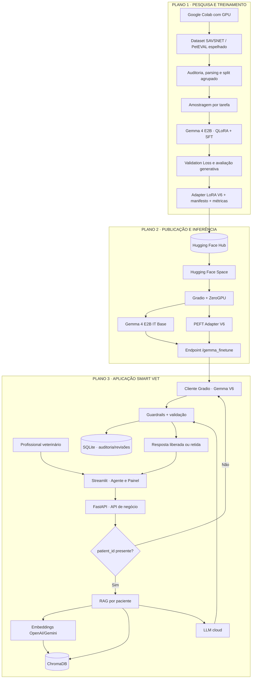

## 🔀 2.2 Fronteiras entre os serviços

| Serviço | Hospedagem/execução | Responsabilidade | Não é responsável por |
|---|---|---|---|
| Notebook de fine-tuning | Google Colab | Preparar dados, treinar, avaliar e publicar adaptador | Servir requisições da aplicação em produção |
| Repositório do adaptador | Hugging Face Hub | Armazenar pesos LoRA, configuração e arquivos associados | Executar inferência por si só sem modelo base |
| Space Gemma | Hugging Face Spaces | Carregar base + adapter, interface comparadora e endpoint Gradio | Consultar prontuários ou executar RAG por paciente |
| FastAPI | Serviço backend Smart VET | Autenticação da aplicação, roteamento, RAG, prontuário e governança | Carregar pesos Gemma localmente |
| Streamlit | Frontend Smart VET | Conversa, seleção de paciente, histórico e visualização de status | Inicializar ChromaDB, carregar LLM ou ingerir PDF diretamente |

## 🔌 2.3 Duas APIs diferentes

É essencial não confundir o endpoint Gradio com a API de negócio:

| Camada | Endpoint | Tecnologia | Contrato |
|---|---|---|---|
| API Smart VET | `POST /chat` | FastAPI | JSON com mensagem, histórico, contexto e paciente opcional |
| Inferência Gemma | `/gemma_finetune` | Evento Gradio | Uma string `prompt` e uma string de resposta |

O cliente Streamlit conversa com FastAPI. O FastAPI, quando escolhe atendimento geral, conversa com o Space usando `gradio_client`. As credenciais do Space não devem ser expostas ao navegador/frontend.

## 🗂️ 2.4 Mapa de módulos da aplicação Fase 3

O mapa abaixo lista somente os arquivos ligados ao agente, RAG, prontuário, configuração e governança documentados nesta fase. Módulos de outras fases não são detalhados aqui.

| Camada | Arquivo | Responsabilidade na Fase 3 |
|---|---|---|
| Backend | `main.py` | Cria a aplicação FastAPI, configura CORS/cabeçalhos, ciclo de vida, middlewares de persistência/governança e registra routers |
| Backend | `core.py` | Carrega configuração, autenticação, clientes LLM cloud e segunda validação por LLM |
| Backend | `agente.py` | Chat, roteamento Gemma/LLM+RAG, cliente Gradio, embeddings, ChromaDB, ingestão PDF/ZIP, prontuário, upload/download e e-mail |
| Backend | `painel.py` | Guardrails, redação de dados, pseudonimização, auditoria SQLite, fila de revisão, callback LangChain e integração LangGraph opcional |
| Frontend | `app.py` | Configura a página Streamlit e organiza a interface da Fase 3 |
| Frontend | `agente.py` | Chat, seleção do paciente, histórico por contexto, fontes, explicabilidade, status de revisão e operações HTTP do prontuário |
| Frontend | `painel.py` | Consome saúde, RAG, LLM, auditoria, notificações e endpoints de revisão humana |
| Serviço externo | `app.py` do Space | Carrega Gemma base + adapter PEFT, cria interface comparadora e endpoint Gradio |

### Cabeçalhos e estado do paciente

A comunicação frontend → FastAPI utiliza `X-API-Key` e, quando aplicável, `X-SmartVet-Patient-ID`. O corpo de `POST /chat` também pode carregar `patient_id` e `context.patient_id`. O backend resolve o contexto; o cabeçalho não deve ser tratado como substituto da validação/autorização do paciente.

---

# 🧱 3. Responsabilidade de cada ambiente

## 3.1 Google Colab — treinamento e avaliação

O Colab é o ambiente de experimentação do Gemma V6. O notebook executa carregamento do dataset, validação do esquema, auditoria de anotações, split interno, amostragem, preparação do template, quantização/carregamento do modelo, aplicação dos adaptadores LoRA, treino supervisionado, validação e avaliação generativa.

**O Colab não hospeda o endpoint usado pelo FastAPI.** A inferência do aplicativo acontece no Hugging Face Space.

## 3.2 Hugging Face Hub — artefatos

O Hub mantém os artefatos versionados do modelo, em especial o adaptador LoRA V6. O repositório do adaptador não contém um modelo autônomo completo: para inferência, o consumidor precisa carregar o Gemma base compatível e aplicar o adapter.

## 3.3 Hugging Face Spaces — runtime de inferência

O Space carrega o Gemma 4 E2B IT base, aplica o adapter PEFT V6, cria a interface Gradio e expõe a função de inferência. A aplicação utiliza infraestrutura GPU disponibilizada pelo Space/ZeroGPU e controla a concorrência de chamadas que usam a GPU.

## 3.4 FastAPI — orquestração da aplicação

O FastAPI decide entre a rota Gemma sem paciente e a rota LLM cloud + RAG com paciente. Também executa as regras de governança, mantém auditoria e fila de revisão e gerencia os serviços documentais.

## 3.5 Streamlit — experiência do usuário

O Streamlit apresenta o agente e o painel. Mantém o histórico da conversa na sessão, separa o estado por contexto de paciente, envia requisições HTTP e renderiza fontes, justificativas, validação e revisão.

---

# 🔄 4. Fluxo completo da Fase 3

A Fase 3 possui uma etapa de preparação de modelo que acontece fora do ciclo de cada requisição e uma etapa online que é executada sempre que o profissional utiliza o agente.

## 4.1 Ciclo offline — do experimento à hospedagem

1. O notebook Colab carrega o dataset e executa auditoria, split, amostragem e fine-tuning.
2. O notebook avalia as três tarefas, gera manifesto/métricas e salva o adapter.
3. O adapter V6 e os arquivos necessários são publicados no Hugging Face Hub.
4. O Space baixa/carrega o Gemma base e aplica o adapter PEFT V6.
5. Gradio expõe o comparador e a API `/gemma_finetune`.

## 4.2 Ciclo online — pergunta geral ou contextual

1. O profissional envia uma mensagem pelo Streamlit.
2. O FastAPI autentica e valida a solicitação.
3. O backend resolve se existe `patient_id`.
4. Sem paciente, chama o Space Gemma V6; com paciente, executa RAG filtrado e LLM cloud.
5. O middleware aplica guardrails e segunda validação cloud quando disponível.
6. A resposta é liberada ou persistida para revisão humana.
7. Streamlit apresenta resposta, fontes, rota e status.

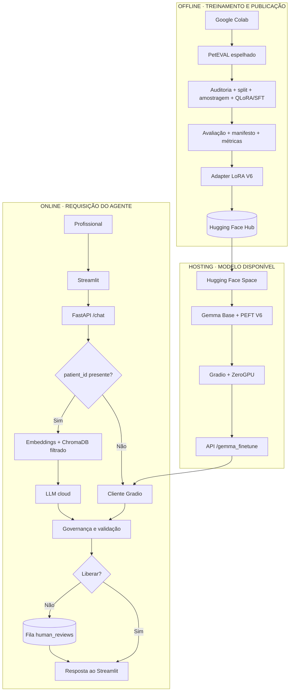

> ⏱️ O treinamento não é executado durante o atendimento. A inferência online utiliza o adapter V6 já publicado e carregado pelo Space. Uma nova versão do modelo exige novo ciclo de treino/avaliação/publicação e atualização controlada do runtime.

---

# 🧠 5. Modelo Gemma 4 E2B — Fine-tuning

## 5.1 Identificação do experimento

| Propriedade | Descrição |
|---|---|
| Projeto | SMART VET — anotação veterinária PetEVAL |
| Experimento publicado | V6 |
| Modelo base | `unsloth/gemma-4-E2B-it` |
| Arquitetura de adaptação | LoRA via PEFT |
| Método de treinamento | QLoRA + Supervised Fine-Tuning (SFT) |
| Dataset espelhado utilizado | `ramoncg/tech-challenge-gemma-llm-fine-tuning-dataset` |
| Adaptador publicado | `ramoncg/tech-challenge-gemma-llm-fine-tuning-adapter-v6` |
| Ambiente documentado | Google Colab com GPU NVIDIA Tesla T4 |
| Notebook | `tech_challenge_gemma_llm_fine_tuning_model.ipynb` |
| Estado | V6 concluída e publicada como adaptador LoRA |

### 🔗 Artefatos públicos

- [Adaptador SMART VET V6 no Hugging Face Hub](https://huggingface.co/ramoncg/tech-challenge-gemma-llm-fine-tuning-adapter-v6)
- [Modelo base Gemma 4 E2B IT](https://huggingface.co/unsloth/gemma-4-E2B-it)
- [Dataset espelhado PetEVAL utilizado na execução](https://huggingface.co/datasets/ramoncg/tech-challenge-gemma-llm-fine-tuning-dataset)
- [Space de inferência e comparação](https://huggingface.co/spaces/ramoncg/smart-vet-gemma-fine-tuning)

## 5.2 O que é publicado: adapter, não checkpoint completo

O artefato V6 publicado contém os pesos do adaptador LoRA e arquivos necessários para carregá-lo com o modelo base. Ele não substitui nem incorpora necessariamente todos os pesos originais do Gemma.

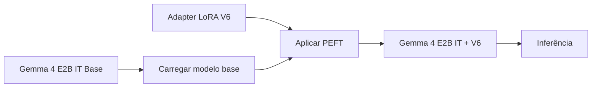

Consequências práticas:

- Baixar somente o adapter não é suficiente para executar o modelo.
- O runtime precisa acessar a base compatível e o repositório do adapter.
- A configuração PEFT e o processor/tokenizer compatível devem ser preservados.
- O Space carrega a base e aplica o adapter; a API FastAPI não faz esse carregamento.
- As versões V3, V4 e V5 são histórico experimental no material fornecido; o adaptador disponibilizado no Hub é V6.

## 5.3 Objetivo científico e escopo da adaptação

O objetivo é reproduzir, em formato estruturado, as anotações humanas das narrativas veterinárias do PetEVAL. A mesma família de modelo generativo recebe instruções específicas para três tarefas:

| Tarefa | Entrada | Saída esperada | Objetivo |
|---|---|---|---|
| ICD-11 multilabel | Narrativa veterinária | Array JSON de strings | Identificar capítulos sindrômicos anotados |
| Disease NER | Narrativa veterinária | Array JSON de `{entity, label}` | Identificar menções de doenças/condições |
| Anonymisation NER | Narrativa veterinária | Array JSON de `{entity, label}` | Identificar entidades relacionadas a privacidade |

**Fora do escopo do fine-tuning:** diagnóstico clínico autônomo, prognóstico, escolha de tratamento, prescrição, cálculo de dose e garantia de anonimização.

---

# 📚 6. Dados PetEVAL e auditoria do dataset

## 6.1 Fonte científica

PetEVAL é um benchmark de registros veterinários eletrônicos em texto livre, derivado de práticas veterinárias de primeira opinião do Reino Unido. O artigo científico descreve 17.600 registros anotados profissionalmente e uma estratégia de partição por clínica/prática para avaliar generalização entre origens distintas.

| Partição descrita no artigo | Registros |
|---|---:|
| Treinamento | 11.000 |
| Avaliação | 1.600 |
| Teste | 5.000 |
| **Total** | **17.600** |

O artigo descreve três tipos de anotação: classificação sindrômica ICD-11, extração de entidades de doenças e anonimização. O desenho clinic-disjoint é importante porque busca evitar que registros da mesma prática apareçam simultaneamente em treino e avaliação/teste.

Referência principal: Farrell et al. (2025), *PetEVAL: A veterinary free text electronic health records benchmark*, Proceedings of the 24th Workshop on Biomedical Language Processing.

## 6.2 Dataset efetivamente acessível na execução V6

A V6 não foi treinada diretamente com as três partições oficiais completas do artigo. O notebook utilizou o espelho:

```text
ramoncg/tech-challenge-gemma-llm-fine-tuning-dataset
```

O esquema validado continha:

| Coluna | Conteúdo | Uso |
|---|---|---|
| `id` | Identificador do registro | Auditoria e rastreabilidade |
| `sentence` | Narrativa clínica em texto livre | Entrada comum das três tarefas |
| `icd_label` | Lista de capítulos sindrômicos | ICD-11 multilabel |
| `disease` | Entidades e spans de doença | Disease NER |
| `annonymisation` | Entidades e spans de anonimização | Anonymisation NER |

> ⚠️ A coluna `annonymisation` contém essa grafia no dataset. O nome é mantido para compatibilidade com a origem e com o notebook; não deve ser renomeado sem atualizar o código que depende dele.

Na execução V6 documentada, o Dataset Viewer expôs somente o split `test`, com **4.999 registros**. A visualização atual do Hub arredonda a dimensão para aproximadamente 5 mil linhas. Não foi disponibilizado um identificador `practice_id`/`clinic_id` utilizável para reproduzir a separação por clínica do paper.

O notebook também contém caminhos condicionais para diferentes disponibilizações futuras do dataset:

| Situação encontrada | Comportamento previsto no pipeline |
|---|---|
| `train` e `validation/evaluation` disponíveis | Utilizar as partições correspondentes |
| `train` disponível sem validação | Criar holdout agrupado dentro de `train` e reservar `test`, quando disponível |
| `train` ausente | Utilizar a partição acessível como origem do split interno; na execução V6 foi `test` |

Esses caminhos condicionais fazem parte da lógica documentada do notebook; não alteram o que ocorreu de fato na execução V6, que utilizou o único split `test` exposto.

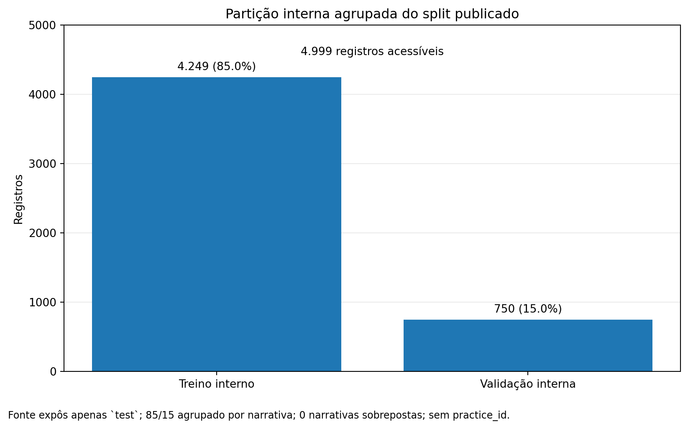

### ⚠️ Limitação metodológica fundamental

Como só o split `test` estava exposto, a execução criou um split interno 85/15 a partir dessa partição. Portanto:

- parte dos registros da partição publicada como `test` foi utilizada no treinamento;
- esse holdout interno não é o teste oficial independente do PetEVAL;
- não foi possível reproduzir a divisão clinic-disjoint por prática;
- as métricas V6 são experimentais e internas;
- não se deve apresentar os resultados como benchmark independente oficial.

## 6.3 Split interno V6

Foi utilizado `GroupShuffleSplit`, com agrupamento pela narrativa normalizada apenas para detectar duplicatas e reduzir a possibilidade de vazamento entre os grupos. O texto original não é normalizado antes das verificações de offsets NER.

| Conjunto | Registros | Percentual aproximado |
|---|---:|---:|
| Treino interno | 4.249 | 85% |
| Validação interna | 750 | 15% |
| **Total** | **4.999** | **100%** |

O processo avaliou 60 candidatos de split e selecionou aquele que melhor aproximava a distribuição dos rótulos ICD e a proporção de registros positivos para Disease/Anonymisation NER.

| Verificação | Resultado documentado |
|---|---|
| Narrativas duplicadas atravessando treino/validação | 0 |
| `practice_id` ou `clinic_id` | Não disponível |
| Split oficial de validação | Não utilizado |
| Teste oficial reservado | Não; a partição exposta foi usada como origem do split interno |
| Avaliação clinic-disjoint | Não realizada |

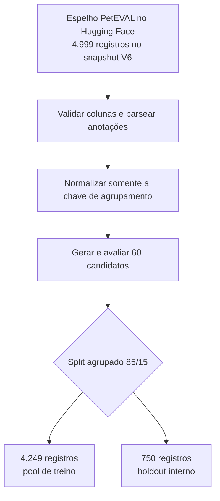

## 6.4 Divergência de taxonomia ICD-11

O artigo descreve 20 capítulos ICD-11 selecionados nos métodos. A transcrição da tabela fornecida no material experimental exibe 19 linhas; o arquivo acessível na V6 apresentou 18 rótulos distintos observados no treino.

O pipeline utiliza o vocabulário observado no conjunto de treino e **não cria classes ausentes por inferência**. A média observada foi de aproximadamente 1,552 rótulos ICD por registro no conjunto interno (treino + validação). Essa média não é diretamente comparável à média do split original do artigo, pois a origem e a composição dos dados não coincidem.

## 6.5 Regras de auditoria e parsing

A preparação dos dados distingue três situações:

| Valor de anotação | Interpretação | Tratamento |
|---|---|---|
| `[]` | Anotação presente sem entidade/rótulo | Negativo supervisionado válido |
| `null` ou campo ausente | Anotação não disponível | Não converter silenciosamente em negativo |
| Valor malformado ou span inválido | Erro de parsing/validação | Registrar como problema de auditoria |

Para as tarefas NER:

- a coluna `sentence` permanece intacta antes da validação dos offsets;
- não se aplica `strip()`, `lower()` ou colapso de espaços antes da validação de spans;
- os offsets utilizam intervalo semiaberto `[start, end)`;
- cada span deve conter `start`, `end`, `entity` e `label`;
- o trecho precisa satisfazer `sentence[start:end] == entity`;
- o parser tenta JSON e literal Python;
- erros são contabilizados, não transformados silenciosamente em exemplos negativos.

## 6.6 Auditoria quantitativa dos conjuntos internos

| Indicador | Treino (4.249) | Validação (750) |
|---|---:|---:|
| ICD anotado | 4.249 | 750 |
| ICD com lista vazia | 1.018 | 180 |
| ICD com pelo menos um rótulo | 3.231 | 570 |
| Total de rótulos ICD | 6.602 | 1.158 |
| Rótulos ICD distintos | 18 | 18 |
| Disease anotado | 4.249 | 750 |
| Disease com lista vazia | 1.793 | 325 |
| Disease com entidade | 2.456 | 425 |
| Spans Disease | 4.968 | 836 |
| Anonymisation anotado | 4.249 | 750 |
| Anonymisation com lista vazia | 3.021 | 531 |
| Anonymisation com entidade | 1.228 | 219 |
| Spans Anonymisation | 1.786 | 316 |
| Narrativas duplicadas após agrupamento | 0 | 0 |

A auditoria V6 registrou `parse_issue_count=0` nos registros processados.

## 6.7 Frequência dos rótulos ICD-11 no treino

| Rótulo ICD-11 | Ocorrências |
|---|---:|
| Certain infectious or parasitic diseases | 1.113 |
| Diseases of the skin | 862 |
| Diseases of the musculoskeletal system or connective tissue | 615 |
| Injury, poisoning or certain other consequences of external causes | 548 |
| Diseases of the visual system | 548 |
| Diseases of the ear or mastoid process | 432 |
| Neoplasms | 422 |
| Mental, behavioural or neurodevelopmental disorders | 404 |
| Diseases of the immune system | 364 |
| Diseases of the respiratory system | 291 |
| Diseases of the genitourinary system | 282 |
| Endocrine, nutritional or metabolic diseases | 264 |
| Diseases of the circulatory system | 154 |
| Diseases of the nervous system | 130 |
| Developmental anomalies | 81 |
| Diseases of the blood or blood-forming organs | 41 |
| Pregnancy, childbirth or the puerperium | 29 |
| Certain conditions originating in the perinatal period | 22 |

Essas contagens correspondem ao split interno de treino, não ao corpus PetEVAL integral.

## 6.8 Frequência de entidades NER

| Tarefa/categoria | Treino | Validação |
|---|---:|---:|
| Disease / `DISEASE` | 4.968 | 836 |
| Anonymisation / `PER` | 1.175 | 203 |
| Anonymisation / `TIME` | 310 | 50 |
| Anonymisation / `ORG` | 145 | 17 |
| Anonymisation / `LOC` | 79 | 15 |
| Anonymisation / `MISC` | 77 | 31 |

Definições operacionais usadas na V6:

| Label | Significado operacional |
|---|---|
| `PER` | Nomes de animais, tutores e profissionais veterinários |
| `LOC` | Cidades, localidades, países e localizações geográficas |
| `ORG` | Clínicas/práticas, hospitais de referência, abrigos, canis, laboratórios e organizações relacionadas |
| `TIME` | Datas, horários, períodos e durações quando anotados |
| `MISC` | Identificadores únicos e dados explícitos de contato, como microchip, apólice, códigos profissionais, telefone, e-mail e passaporte |

A definição de `MISC` prioriza a seção principal 4.1.1 do artigo. A V6 não classifica automaticamente medicamentos ou procedimentos como identificadores pessoais.

---

# ⚙️ 7. Pipeline de treinamento QLoRA + SFT

## 7.1 Conceito operacional

A base Gemma é carregada quantizada em 4-bit para reduzir consumo de memória. Em vez de atualizar todos os pesos originais, o fine-tuning ajusta matrizes adicionais LoRA associadas às camadas selecionadas. O treino é supervisionado: cada registro recebe uma instrução de tarefa e um alvo estruturado em JSON.

### Componentes da implementação V6

- `FastVisionModel` do Unsloth é utilizado para carregar a família Gemma 4.
- As camadas visuais permanecem congeladas (`finetune_vision_layers=False`).
- As camadas de linguagem são adaptadas via LoRA.
- Os módulos de atenção e MLP recebem adaptadores.
- A base é carregada em 4-bit.
- O adaptador é salvo separadamente da base.

`FastVisionModel` é utilizado como caminho de carregamento compatível com a família Gemma 4 no Unsloth. O experimento descrito é textual; as camadas visuais não são treinadas.

## 7.2 Configuração LoRA

| Parâmetro | Valor V6 |
|---|---:|
| Rank (`r`) | 16 |
| Alpha | 32 |
| Dropout | 0,05 |
| Bias | `none` |
| Quantização da base | 4-bit |
| Gradient checkpointing | Unsloth |
| Camadas de visão treinadas | Não |
| Camadas de linguagem | Sim, via LoRA |
| Módulos | Atenção e MLP |
| Parâmetros totais reportados | 5.128.455.712 |
| Parâmetros treináveis | 24.158.208 |
| Fração treinável reportada | 0,4711% |

A proporção treinável é `24.158.208 / 5.128.455.712`. Ela indica quantos parâmetros são atualizados, não a proporção de registros ou tokens do dataset.

## 7.3 Preparação das conversas e chat template

Cada exemplo de treino é convertido em duas mensagens:

1. `user`: instrução da tarefa + narrativa original;
2. `assistant`/`model`: resposta-alvo JSON.

O notebook utiliza `get_chat_template(..., chat_template="gemma-4")` e valida a presença dos marcadores de turno esperados antes de construir o dataset SFT.

## 7.4 Máscara response-only

A função `train_on_responses_only` mascara os tokens do prompt/instrução para calcular a loss somente sobre os tokens da resposta supervisionada. Os tokens que não devem contribuir para a loss recebem label `-100`.

Marcadores utilizados no notebook:

```python
instruction_part = "<|turn>user\n"
response_part = "<|turn>model\n"
```

O pipeline verifica que o primeiro exemplo de treino e o primeiro exemplo de validação tenham tokens supervisionados depois da aplicação da máscara. Na primeira amostra da validação foram registrados **16 tokens supervisionados**; isso é uma observação daquela amostra, não a média de toda a validação.

> 📐 **Comparabilidade:** uma loss calculada sobre prompt + resposta não é comparável diretamente com uma loss calculada somente sobre a resposta. As comparações V5/V6 descritas aqui usam o protocolo `response-only` documentado.

## 7.5 Limite de contexto e preservação dos offsets

`MAX_SEQ_LENGTH=1024`.

O notebook tokeniza sem truncamento silencioso e exclui exemplos que ultrapassam o limite, evitando cortar a narrativa e invalidar offsets de NER.

| Conjunto | Mantidos | Descartados por comprimento |
|---|---:|---:|
| Treino SFT | 516 | 0 |
| Validação SFT | 144 | 0 |
| Avaliação generativa | Até 180 | 0 |

Comprimento tokenizado registrado:

| Estatística | Treino | Validação SFT |
|---|---:|---:|
| Média | 414,63 | 384,31 |
| Mediana | 402 | 377 |
| Percentil 95 | 617,25 | 563,85 |
| Máximo | 927 | 677 |

## 7.6 Fluxo completo do treinamento

```mermaid
flowchart TD
    A[Google Colab + GPU CUDA] --> B[Autenticação Hugging Face]
    B --> C[Carregar dataset espelhado]
    C --> D[Validar colunas e parsear anotações]
    D --> E[Preservar texto e validar offsets]
    E --> F[Split agrupado interno 85/15]
    F --> G[Auditoria de treino e validação]
    G --> H[Montar pools ICD / Disease / Anonymisation]
    H --> I[Amostrar 172 exemplos por tarefa]
    I --> J[Renderizar chat template Gemma 4]
    J --> K[Tokenizar sem truncamento silencioso]
    K --> L[Carregar Gemma 4 E2B em 4-bit]
    L --> M[Aplicar adaptadores LoRA]
    M --> N[Mascarar prompt e supervisionar resposta]
    N --> O[SFT: 129 passos, limite de 600 segundos]
    O --> P[Salvar adapter e arquivos de auditoria]
    P --> Q[Validation Loss response-only]
    Q --> R[Avaliação generativa por tarefa]
    R --> S[Parsing JSON e reconstrução de spans]
    S --> T[Precision / Recall / F1 / Exact Match]
    T --> U[Manifesto + métricas + predições]
    U --> V[Publicar adapter V6 no Hugging Face Hub]
```

## 7.7 Fluxo interno QLoRA + SFT

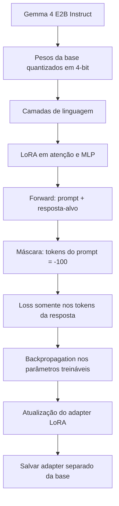

---

# 🧾 8. Construção dos alvos e tarefas supervisionadas

## 8.1 ICD-11 multilabel

**Entrada:** narrativa veterinária (`sentence`).  
**Saída:** array JSON com zero ou mais capítulos ICD-11 observados no conjunto de treino.

Exemplo:

```json
[
  "Diseases of the skin",
  "Certain infectious or parasitic diseases"
]
```

Regras:

- Permitir múltiplos rótulos se o texto sustentar mais de um capítulo.
- Usar a grafia exata do vocabulário observado no treino.
- Retornar `[]` quando nenhum capítulo estiver sustentado pela narrativa.
- Não inferir diagnóstico que não esteja expresso ou sustentado pelo texto.
- Na avaliação, normalizar caixa e espaços e comparar por correspondência exata.
- Rótulos desconhecidos não são descartados silenciosamente: contam como falsos positivos.
- O universo da macro-métrica inclui o vocabulário conhecido no treino.

## 8.2 Disease NER

A política de anotação inclui menções explícitas de doenças/condições, por exemplo:

- diagnósticos;
- suspeitas e diagnósticos diferenciais;
- descrições sindrômicas de condições;
- patógenos;
- exceto quando a menção está explicitamente negada.

Sintomas isolados, medicamentos, tratamentos e achados gerais não devem ser convertidos em doenças por inferência.

Formato-alvo SFT:

```json
[
  {"entity": "otitis", "label": "DISEASE"}
]
```

O alvo não inclui offsets numéricos. O pós-processamento procura a substring literal na narrativa original e reconstrói `start` e `end`. Quando a mesma superfície aparece várias vezes, o algoritmo associa as ocorrências em ordem, usando a primeira ainda não utilizada. Isso reduz erros de geração de offsets, mas não elimina ambiguidade em textos repetitivos.

## 8.3 Anonymisation NER

A saída contém entidades anotadas com as categorias observadas: `PER`, `LOC`, `ORG`, `TIME` e `MISC`.

Exemplo:

```json
[
  {"entity": "Example Veterinary Practice", "label": "ORG"},
  {"entity": "12/03/2024", "label": "TIME"}
]
```

A avaliação exige correspondência exata de texto, offsets e categoria. Categorias fora do vocabulário permitido são rejeitadas e contabilizadas como erros.

> 🔐 **Limite de segurança:** o modelo não oferece garantia de anonimização. Falsos negativos ainda podem expor dados pessoais. A saída não deve ser utilizada como única barreira de desidentificação.

## 8.4 Protocolo de geração usado na avaliação

A avaliação generativa documentada utiliza decodificação determinística (`do_sample=False`) e limites de novos tokens específicos por tarefa:

| Parâmetro | Valor |
|---|---:|
| `do_sample` | `False` |
| `MAX_NEW_TOKENS_ICD` | 96 |
| `MAX_NEW_TOKENS_NER` | 256 |

As respostas são convertidas a partir de JSON. Falhas de parsing, itens inválidos, rótulos desconhecidos e spans inválidos são registrados conforme a tarefa. Esses limites pertencem ao pipeline de avaliação V6; não devem ser confundidos com o limite de 768 novos tokens da API `free_qa` do Space.

## 8.5 JSON e pós-processamento de spans

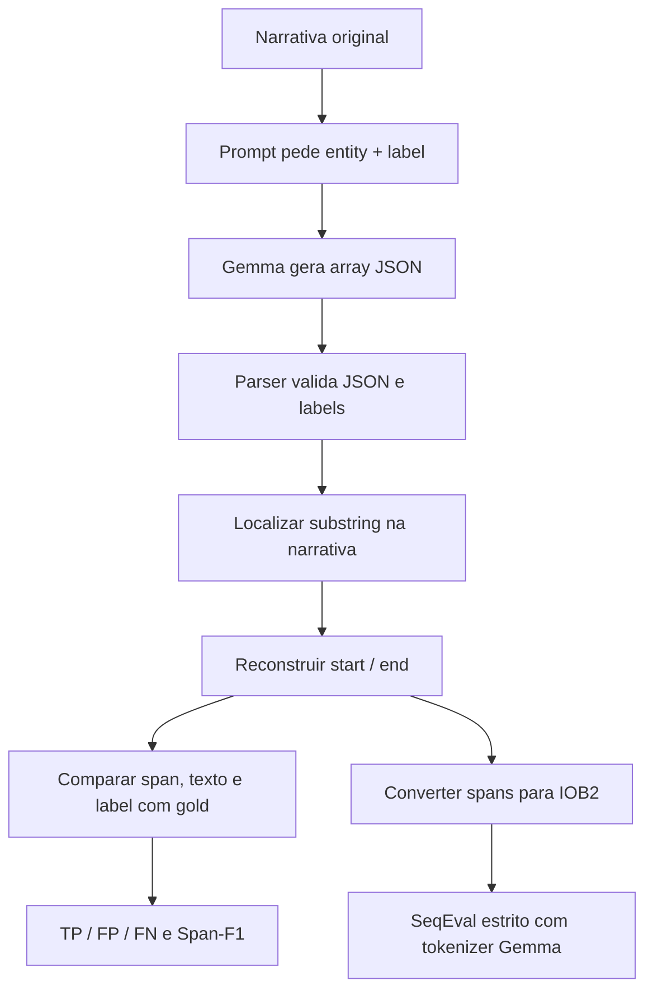

---

# 🎛️ 9. Amostragem e configuração experimental V6

## 9.1 Amostragem por tarefa

O pool interno de treino tinha 4.249 registros disponíveis para cada tarefa. Para caber no orçamento de tempo da GPU, foram selecionados 172 exemplos task-labeled por tarefa.

| Tarefa | Positivos | Negativos (`[]`) | Total |
|---|---:|---:|---:|
| ICD-11 | 131 | 41 | 172 |
| Disease NER | 99 | 73 | 172 |
| Anonymisation NER | 50 | 122 | 172 |
| **Total** | **280** | **236** | **516** |

Os 516 exemplos task-labeled correspondem a **478 IDs de registros de origem distintos**, pois um registro pode fornecer mais de uma tarefa.

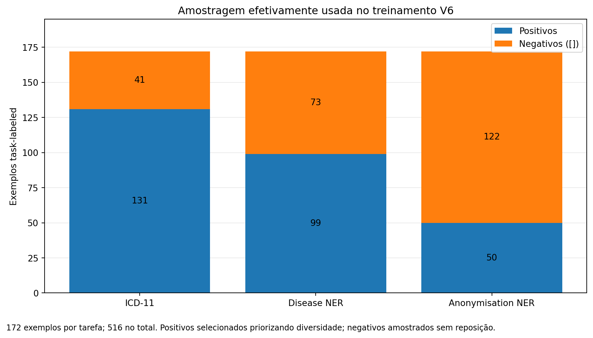

### Critério de seleção

- Positivos selecionados com estratégia gulosa voltada à diversidade.
- ICD: priorização de rótulos raros.
- NER: cobertura de categorias e superfícies textuais normalizadas das entidades.
- Negativos amostrados em pools separados.
- Seleção sem reposição dentro de cada pool de tarefa.

### Nota sobre funções auxiliares

O notebook contém utilitários para ponderação inversa à raiz quadrada dos rótulos ICD, oversampling de positivos NER e balanceamento de pools (`rebalance_icd_rare_labels`, `oversample_ner_positives`, `balance_task_pools`). O caminho que construiu a amostra V6 documentada **não chamou `balance_task_pools`**. A amostra registrada foi construída diretamente com `sample_short_task_pool`, quotas positivas fixas e seleção gulosa por diversidade.

## 9.2 Validation Loss e avaliação generativa são conjuntos diferentes

| Finalidade | ICD-11 | Disease NER | Anonymisation NER | Total |
|---|---:|---:|---:|---:|
| Validation Loss SFT | 48 | 48 | 48 | **144** |
| Avaliação generativa F1 | 60 | 60 | 60 | **180** |

Validation Loss utiliza amostra fixa/estratificada compatível com o protocolo comparativo V5, com máscara response-only. A avaliação generativa usa até 60 registros por tarefa do pool de validação, preservando aproximadamente a proporção de exemplos positivos e negativos.

## 9.3 Ambiente documentado

| Componente | Registro da execução |
|---|---|
| Ambiente | Google Colab |
| GPU | NVIDIA Tesla T4 |
| VRAM reportada | 14,56 GB |
| BF16 | Não suportado pela T4 nessa execução |
| PyTorch | `2.14.1+cu130` no log fornecido |
| Transformers | `5.17.0` no log fornecido |
| Unsloth | `2026.11.8` no log fornecido |
| Quantização | 4-bit |
| Contexto máximo | 1.024 tokens |
| `fp16` | `False` |
| `bf16` | `False` |

O log registrou incompatibilidade entre a combinação instalada de `xformers` e PyTorch/CUDA, com fallback para atenção do PyTorch. As versões são um snapshot do runtime documentado e não um lockfile; o notebook usa limites mínimos de versão, então execuções futuras podem resolver dependências diferentes.

## 9.4 Hiperparâmetros SFT

| Parâmetro | Valor V6 |
|---|---:|
| Épocas solicitadas | 1 |
| Exemplos task-labeled | 516 |
| Exemplos por tarefa | 172 |
| Batch por dispositivo | 1 |
| Gradient accumulation | 4 |
| Batch efetivo nominal | 4 |
| Passos-alvo | 129 |
| Learning rate | `2e-5` |
| Scheduler | `cosine` |
| Warmup | 6 passos |
| Otimizador | `adamw_8bit` |
| Weight decay | 0,01 |
| Max gradient norm | 0,3 |
| Logging | A cada 5 passos |
| Eval automático durante treino | Desativado (`eval_strategy="no"`) |
| Checkpoints periódicos | Desativados (`save_strategy="no"`) |
| Limite de duração | 600 s |
| Packing | Desativado |
| DataLoader workers | 0 |
| Seed | 3407 |

Com batch 1 e acumulação 4, `ceil(516 / 4) = 129` passos. A V6 corresponde a uma passagem sobre o subconjunto task-labeled, não a uma época completa dos 4.249 registros disponíveis no pool interno nem do corpus PetEVAL integral.

## 9.5 Orçamento de tempo

O callback `TenMinuteTrainingBudgetCallback` utiliza relógio monotônico e interrompe o treino quando o orçamento de 600 segundos é atingido no limite de passo. Uma passagem só é considerada completa quando `global_step` alcança os 129 passos previstos.

| Medição | Resultado |
|---|---:|
| Trainer runtime | 530,99 s |
| Duração externa da célula | 532,83 s |
| Passos concluídos | 129/129 |
| Passagens completas | 1/1 |
| Passos parciais adicionais | 0 |

---

# 📊 10. Resultados experimentais V6

> Os resultados abaixo são os números documentados na execução V6. Eles não são um benchmark oficial independente e não devem ser interpretados como validação clínica.

## 10.1 Resumo executivo

| Indicador | Resultado V6 |
|---|---:|
| Modelo base | `unsloth/gemma-4-E2B-it` |
| Dataset espelhado | `ramoncg/tech-challenge-gemma-llm-fine-tuning-dataset` |
| Registros acessíveis no snapshot | 4.999 |
| Split interno | 4.249 treino / 750 validação |
| Exemplos SFT | 516 (172 por tarefa) |
| Validation Loss SFT | 144 (48 por tarefa) |
| Avaliação generativa | 60 por tarefa |
| Passos de otimização | 129/129 |
| Runtime Trainer | 530,99 s (~8,85 min) |
| Training Loss agregada | 0,500326 |
| Validation Loss response-only | 0,258302 |
| ICD-11 Micro-F1 | 37,68% |
| Disease NER Span-F1 | 31,58% |
| Anonymisation NER Span-F1 | 15,79% |
| Parâmetros treináveis | 24.158.208 (0,4711%) |

## 10.2 Training Loss e Validation Loss

| Métrica | Valor |
|---|---:|
| Training Loss agregada pelo Trainer | 0,5003256511 |
| Último log de treino (passo 125) | 0,272728 |
| Validation Loss response-only após passo 129 | 0,2583020926 |
| Runtime Trainer | 530,9905 s |
| Duração externa | 532,83 s |

Os pontos de treino eram registrados a cada cinco passos; não representam médias de época. A Validation Loss foi avaliada após o treino com os 144 exemplos mascarados para response-only.

**Gráfico original preservado — evolução da Training Loss**

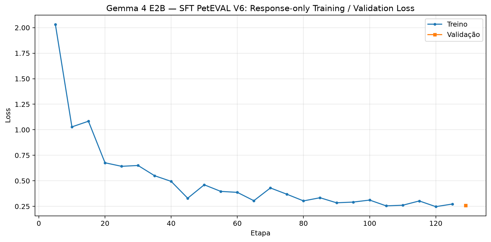

*Gráfico original preservado, sem alteração do conteúdo. Esta figura complementa os valores agregados apresentados na tabela.*

**Gráfico original preservado — Training Loss e Validation Loss da V6**

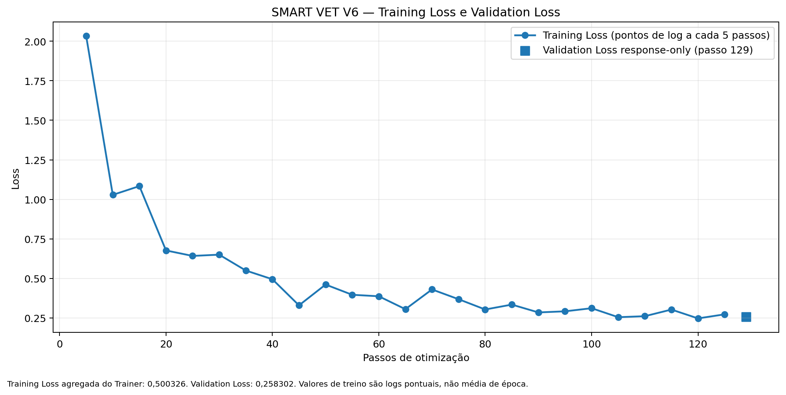

*Gráfico original preservado, usado para consulta visual conjunta das curvas de treino e validação.*

### Comparação response-only

| Experimento | Validation Loss |
|---|---:|
| V5 original, reavaliação consistente | 0,362769 |
| V5 após segunda etapa, melhor ponto (passo 8) | 0,375197 |
| V6 final | **0,258302** |

A V6 ficou aproximadamente **28,8% abaixo** da V5 original nessa métrica. Isso significa perda média menor nos tokens de resposta avaliados sob aquele protocolo; não demonstra, isoladamente, melhor classificação ou extração.

Um valor anterior próximo de 5,9 foi obtido com máscara inconsistente que incluía prompt e resposta e não deve ser comparado a resultados response-only.

**Comparação original preservada — Validation Loss V5 × V6**

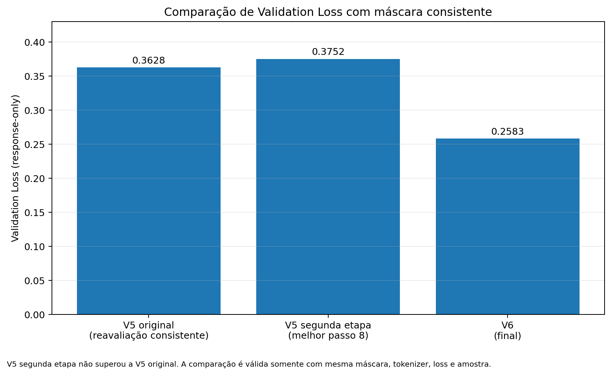

*Gráfico original preservado. A leitura deve considerar a mesma configuração response-only e as limitações da amostragem descritas nesta seção.*

**Gráficos complementares preparados para esta documentação**

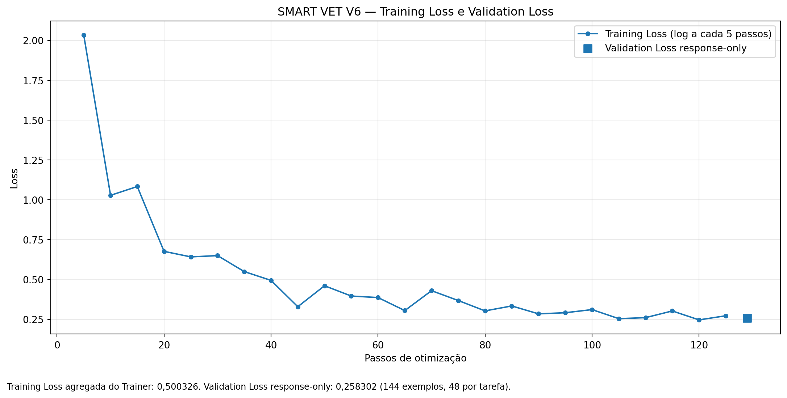

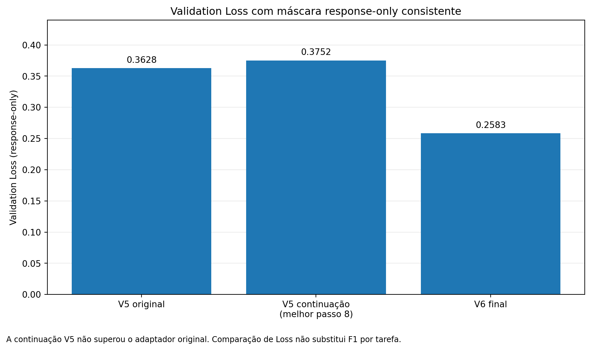

## 10.3 Avaliação ICD-11 multilabel — 60 registros

| Métrica | Resultado |
|---|---:|
| Amostras | 60 |
| Vocabulário de métricas | 18 rótulos |
| TP / FP / FN | 26 / 20 / 66 |
| Micro Precision | 56,52% |
| Micro Recall | 28,26% |
| **Micro-F1** | **37,68%** |
| Macro Precision | 34,29% |
| Macro Recall | 21,34% |
| **Macro-F1** | **23,55%** |
| Weighted Precision | 44,30% |
| Weighted Recall | 28,26% |
| **Weighted-F1** | **31,44%** |
| Exact Match | 28,33% |
| Predições vazias | 18 |
| Erros de parsing/itens inválidos | 3 |
| Rótulos desconhecidos previstos | 0 |

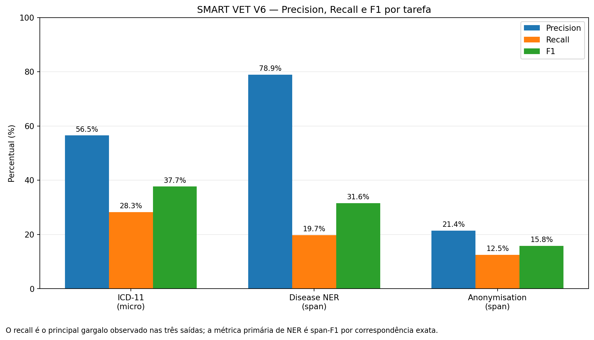

**Interpretação:** a precisão micro foi maior que o recall. Foram perdidos 66 rótulos de referência (FN), indicando cobertura limitada.

## 10.4 Disease NER — 60 registros

| Métrica | Resultado |
|---|---:|
| Registros com entidades gold | 34 |
| Registros com gold vazio | 26 |
| Spans gold | 76 |
| Spans previstos válidos | 19 |
| TP / FP / FN | 15 / 4 / 61 |
| Span Precision | 78,95% |
| Span Recall | 19,74% |
| **Span-F1** | **31,58%** |
| SeqEval strict IOB2 F1 | 31,91% |
| Exact record match | 50,00% |
| Predições vazias | 50 |
| Erros de JSON | 0 |
| Conflitos de sobreposição de tokens | 3 |

**Interpretação:** quando o modelo gera uma entidade, a precisão é relativamente alta; porém, ele recupera poucas das 76 entidades de referência. O recall é o principal gargalo.

## 10.5 Anonymisation NER — 60 registros

| Métrica | Resultado |
|---|---:|
| Registros com entidades gold | 18 |
| Registros com gold vazio | 42 |
| Spans gold | 24 |
| Spans previstos válidos | 14 |
| TP / FP / FN | 3 / 11 / 21 |
| Span Precision | 21,43% |
| Span Recall | 12,50% |
| **Span-F1** | **15,79%** |
| SeqEval strict IOB2 F1 | 15,79% |
| Exact record match | 68,33% |
| Predições vazias | 52 |
| Erros de JSON | 0 |

**Interpretação:** o F1 por span é baixo e o suporte positivo pequeno. O Exact record match relativamente alto é influenciado pelos muitos registros com gold vazio e não significa boa recuperação de identificadores.

## 10.6 Anonymisation por categoria

| Categoria | V5 F1 histórico | V6 F1 | Suporte gold V6 | Predições V6 |
|---|---:|---:|---:|---:|
| LOC | 100,00% | 100,00% | 1 | 1 |
| MISC | 20,00% | 0,00% | 1 | 6 |
| ORG | 50,00% | 66,67% | 2 | 1 |
| PER | 26,67% | 0,00% | 13 | 1 |
| TIME | 13,33% | 16,67% | 7 | 5 |

**Gráfico original preservado — F1 por categoria de anonimização**

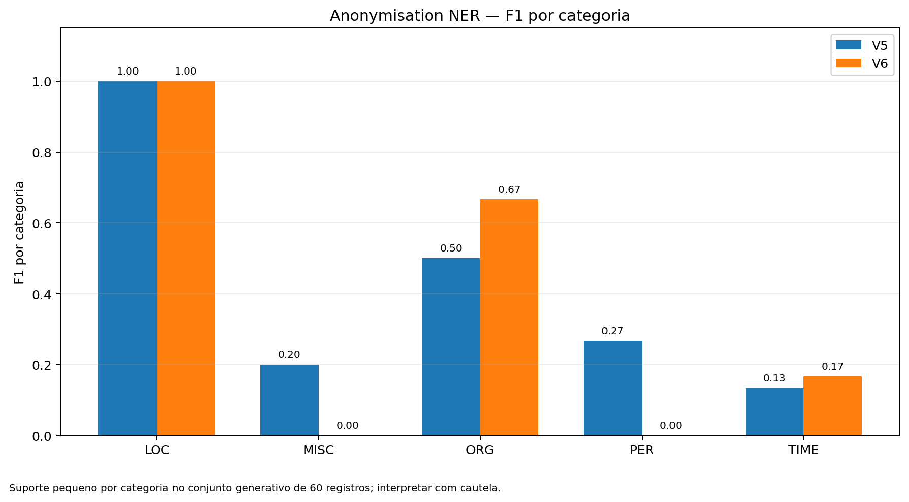

*Gráfico original preservado. O suporte por categoria é pequeno; em especial, LOC possui somente uma entidade gold na amostra V6.*

**Gráfico complementar**

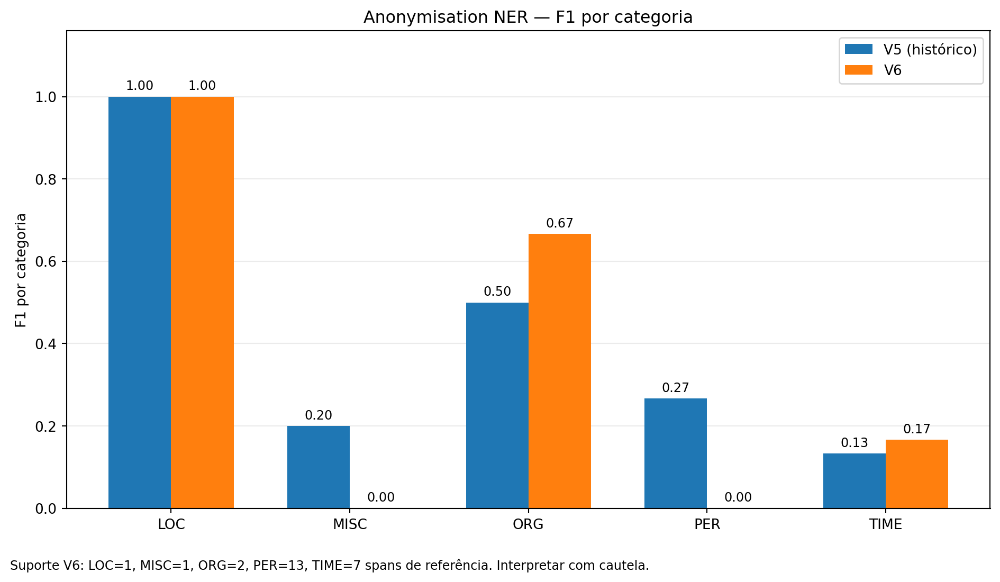

Esses números não sustentam generalizações por categoria. LOC 100% depende de uma única entidade gold. PER é um problema relevante: havia 13 entidades gold, mas apenas uma previsão e nenhum verdadeiro positivo.

## 10.7 Como interpretar as métricas

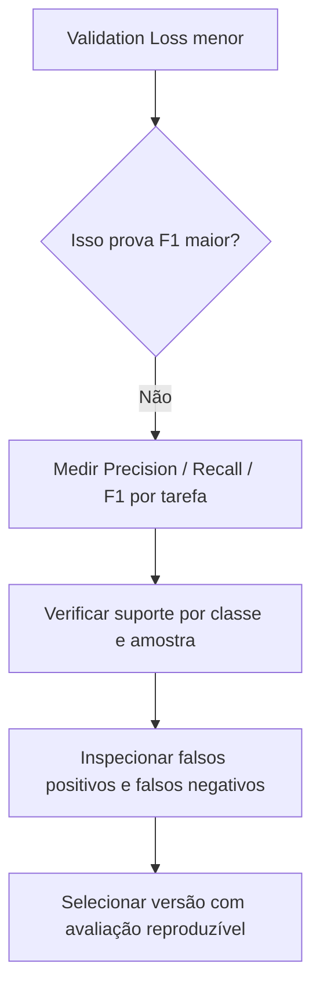

Uma loss menor não garante um F1 maior. A escolha de modelo deve considerar as métricas específicas das três tarefas, a estabilidade da amostra, a qualidade do parsing e as limitações da avaliação.

---

# 🧬 11. Histórico V3–V6 e interpretação

As versões V3 a V6 fazem parte do histórico técnico do fine-tuning Gemma desta fase. Somente V6 está descrita como adaptador publicado no Hub.

## 11.1 Evolução das métricas

| Versão | ICD-11 Micro-F1 | ICD-11 Macro-F1 | Disease NER Span-F1 | Anonymisation NER Span-F1 | Avaliação por tarefa |
|---|---:|---:|---:|---:|---:|
| V3 | 27,50% | — | 2,82% | 0,00% | 30 registros |
| V4 | 32,84% | 18,65% | **44,44%** | 24,00% | 30 registros |
| V5 | **41,22%** | **23,94%** | 35,42% | **26,23%** | 60 registros |
| V6 | 37,68% | 23,55% | 31,58% | 15,79% | 60 registros |

**Gráfico original preservado — comparação das métricas F1 V3–V6**

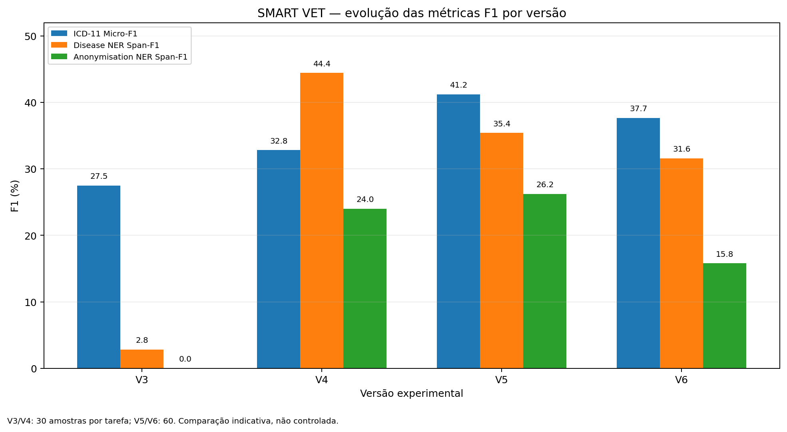

*Gráfico original preservado. As versões não constituem uma comparação controlada, pois houve alterações de amostragem, volume de treino, formulação dos alvos e tamanho da avaliação.*

**Gráfico complementar**

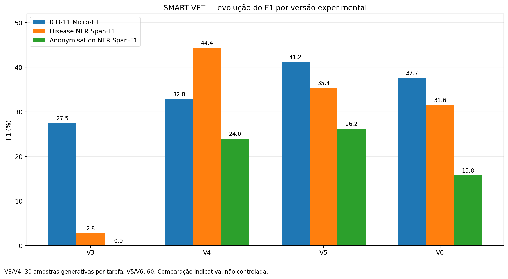

V3/V4 utilizaram 30 registros por tarefa; V5/V6 utilizaram 60. Também houve mudanças no volume de treino, amostragem e formulação dos alvos NER. A tabela é indicativa e não representa um benchmark rigorosamente controlado.

## 11.2 Histórico de treinamento

| Versão | Desenho | Passos | Tempo observado | Observação |
|---|---|---:|---:|---|
| V3 | 60 exemplos por miniépoca (20 por tarefa), seis miniépocas planejadas | 86/90 | ~6 min | Parou no limite; progresso reportado de ~5,73 épocas |
| V4 | 48 exemplos por miniépoca (16 por tarefa), seis miniépocas | 72/72 | 5,13 min | Seis miniépocas completas |
| V5 | 288 exemplos task-labeled (96 por tarefa), uma passagem | 72/72 | 5,31 min | Maior diversidade; melhor conjunto de F1 reportado |
| V6 | 516 exemplos task-labeled (172 por tarefa), uma passagem | 129/129 | 8,85 min | Menor Validation Loss response-only; F1 abaixo de V5 |

A escala de exemplos não possui exatamente o mesmo significado em todas as versões: V3/V4 descrevem exemplos por miniépoca; V5/V6 descrevem o total de uma passagem.

**Gráfico original preservado — tempo e exemplos por versão**

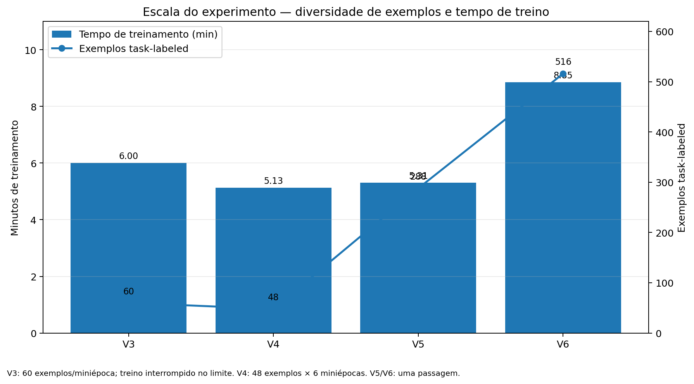

*Gráfico original preservado. Observe que os tempos e as quantidades correspondem a desenhos experimentais diferentes entre V3, V4, V5 e V6.*

**Gráfico complementar**

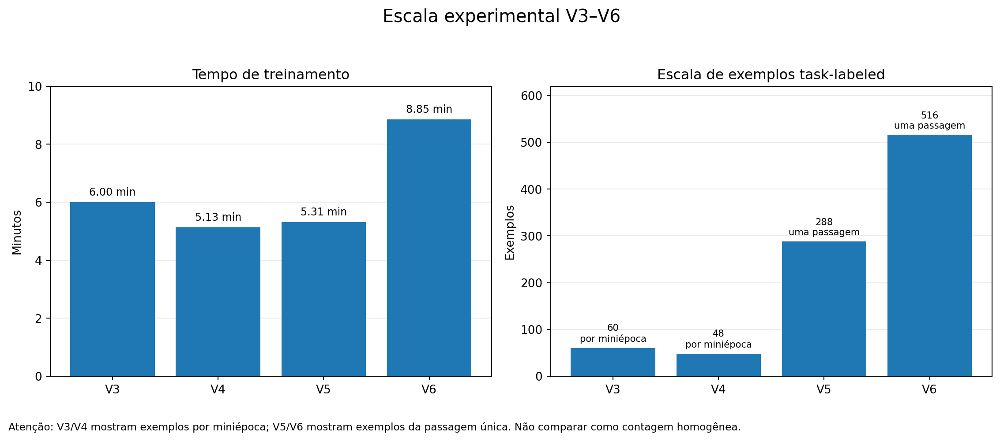

## 11.3 V3 — primeira configuração rápida

- 60 exemplos task-labeled por miniépoca: 20 por tarefa.
- Seis miniépocas planejadas, com 90 passos esperados.
- A execução alcançou 86/90 passos antes do limite de tempo.
- O registro inicial arredondava o progresso para seis épocas, embora o Trainer reportasse cerca de 5,73; isso motivou a contagem corrigida baseada em passos completos.
- A primeira formulação NER solicitava offsets numéricos. Disease NER ficou em 2,82% F1 e Anonymisation NER não teve acertos na avaliação inicial.

## 11.4 V4 — miniépocas menores e NER por texto literal

- 48 exemplos task-labeled por miniépoca: 16 por tarefa.
- 72 passos e seis miniépocas completas em aproximadamente 5,13 minutos.
- A saída NER passou a ser `entity + label`; o pós-processamento reconstrói offsets na narrativa original.
- Disease NER chegou a 44,44% Span-F1 nessa avaliação.

## 11.5 V5 — maior diversidade

- 288 exemplos task-labeled: 96 por tarefa.
- Uma passagem, 72 passos, aproximadamente 5,31 minutos.
- Amostragem voltada à cobertura de rótulos ICD-11 e categorias NER, com positivos e negativos.
- Instruções aproximadas da política de anotação do artigo.
- Melhor conjunto de F1 entre os registros históricos apresentados.
- Não há adaptador V5 publicado no projeto descrito.

## 11.6 Continuação experimental sobre V5

Foi testada uma segunda etapa sobre V5 com learning rate `5e-6`, até 24 passos e avaliação a cada 8 passos:

| Passo | Validation Loss response-only |
|---:|---:|
| 8 | 0,375197 |
| 16 | 0,399793 |
| 24 | 0,392677 |

Comparação:

- V5 original: `0,362769`;
- melhor ponto da continuação (passo 8): `0,375197`.

A continuação foi aproximadamente 3,43% pior que a V5 original nessa medição. O adapter original foi preservado; esse histórico não significa que um adapter V5 tenha sido publicado.

## 11.7 V6 — perfil de dez minutos

- 516 exemplos task-labeled, 172 por tarefa.
- Uma passagem, 129 passos.
- Limite rígido de 600 segundos.
- Execução concluída em 530,99 s segundo o Trainer e 532,83 s na medição externa.
- Training Loss agregada `0,500326`.
- Validation Loss response-only `0,258302`.
- F1 generativo abaixo de V5 nas três tarefas.

## 11.8 Lições extraídas do histórico

1. **Loss menor não garante F1 maior.** A V6 apresentou a menor loss response-only comparada, mas não superou V5 no F1 das tarefas.
2. **NER com texto literal foi mais consistente do que offsets gerados.** Mesmo assim, alinhamento por substring pode falhar com ocorrências repetidas.
3. **Mais exemplos não garantem ganho.** Diversidade e qualidade de amostragem importam tanto quanto quantidade.
4. **A V6 tende a subextrair.** As respostas vazias são numerosas e os recalls de Disease/Anonymisation são baixos.
5. **Negativos supervisionados são necessários.** `[]` ensina o modelo a não gerar entidades/rótulos sem anotação.
6. **Loss comparável exige protocolo fixo.** Amostra, máscara, tokenizer, truncamento, alvo e configuração precisam permanecer consistentes.
7. **Mais etapas de treino não garantem melhoria.** A continuação V5 com `5e-6` não superou a avaliação original.
8. **Protótipo não é benchmark.** O split utilizado não reproduz separação por clínica do artigo.

---

# ☁️ 12. Reprodução do treinamento no Google Colab

## 12.1 Requisitos

- Google Colab com GPU CUDA habilitada. A execução documentada utilizou Tesla T4.
- Acesso ao dataset `ramoncg/tech-challenge-gemma-llm-fine-tuning-dataset` ou a um espelho com o mesmo esquema.
- Conta Hugging Face e permissão de leitura para recursos que exijam autenticação.
- Token Hugging Face com escopo `Read` para baixar e `Write` para publicar o adapter.
- Google Drive montado para persistência, recomendado.

## 12.2 Secret do Colab

O notebook procura o Secret do Colab chamado `api-face`. A revisão V6 corrigiu a leitura para aceitar uma string ou uma estrutura/dicionário de Secret. Se o Secret não estiver disponível, o notebook solicita o token por entrada oculta (`getpass`).

O nome `api-face` é o nome do Secret usado no notebook documentado; não é uma API key do Smart VET nem a credencial Basic Auth do Space.

## 12.3 Execução passo a passo

1. Abrir o notebook `SMART VET Gemma 4 PetEVAL V6`.
2. Em **Ambiente de execução → Alterar tipo de ambiente de execução**, selecionar GPU.
3. Configurar o Secret `api-face` e habilitar seu acesso pelo notebook.
4. Conferir `DATASET_ID`, `MODEL_ID` e permissões do Hugging Face.
5. Executar a célula principal única.
6. Acompanhar carregamento, auditoria, split, amostragem, carregamento Gemma, SFT, Validation Loss response-only, inferência e métricas.
7. Ao final, conferir os caminhos de saída do adapter, manifesto, auditoria, métricas e predições.
8. Opcionalmente, executar a célula de exportação ZIP.

## 12.4 Arquivos produzidos pelo notebook

| Arquivo/pasta | Conteúdo |
|---|---|
| `training_manifest.json` | Configuração, split, amostragem, passos, runtime, parâmetros, publicação, resultados e limitações |
| `peteval_data_audit.json` | Quantidades, rótulos, spans, listas vazias, distribuições e filtros |
| `training_metrics.json` | Métricas do Trainer, Validation Loss e logs |
| `evaluation_metrics.json` | Métricas ICD-11, Disease NER e Anonymisation NER |
| `evaluation_predictions.jsonl` | Referências e predições estruturadas por tarefa, spans e indicadores de parsing |
| `training_loss.png` | Curva de loss |
| `adapter/` | Adaptador LoRA e configuração PEFT para uso com o Gemma base |

Os arquivos agregados de manifesto e métricas não devem incluir narrativas clínicas brutas. O `evaluation_predictions.jsonl` inclui IDs e spans; deve ser tratado como artefato de pesquisa controlado e não publicado sem avaliação de privacidade.

## 12.5 Exportação ZIP dos artefatos

A célula extra de exportação documentada:

1. exige que `OUTPUT_DIR` exista;
2. percorre os arquivos recursivamente, ignorando symlinks;
3. registra nome, tamanho e caminho relativo;
4. cria `SMART_VET_V6_<RUN_ID>_COMPLETO.zip` em `/content`;
5. adiciona `EXPORT_INVENTORY.txt` ao pacote;
6. valida o arquivo com `ZipFile.testzip()`;
7. copia o pacote para `MyDrive/Gemma/SmartVET_PetEVAL/exports/` se o Drive estiver montado;
8. inicia o download pelo navegador do Colab.

Essa célula empacota os arquivos já produzidos em `OUTPUT_DIR`; não realiza treinamento nem cria um novo checkpoint.

## 12.6 Estrutura de materiais do experimento

Estrutura descrita para o pacote de notebook e seus artefatos:

```text
assets/imgs/
├── grafico_original_metricas_f1_v3_v6.png
├── grafico_original_tempo_exemplos.png
├── grafico_original_training_loss.png
├── grafico_original_v6_training_validation_loss.png
├── grafico_original_validation_loss_v5_v6.png
├── grafico_original_anonymisation_por_categoria.png
│   ├── split_dados_v6.png
│   ├── amostragem_v6.png
│   ├── escala_v3_v6.png
│   ├── curva_loss_v6.png
│   ├── comparacao_validation_loss.png
│   ├── precision_recall_f1_v6.png
│   ├── anon_f1_categorias.png
│   └── f1_evolucao_v3_v6.png
└── notebooks/
    └── modelo-gemma-fine-tuning/
        ├── tech_challenge_gemma_llm_fine_tuning_model.ipynb
        └── artefatos.zip
```


---

# 🤗 13. Hospedagem no Hugging Face Spaces

## 13.1 Space de inferência

O artefato V6 é servido por um Hugging Face Space próprio:

- **Space:** [ramoncg/smart-vet-gemma-fine-tuning](https://huggingface.co/spaces/ramoncg/smart-vet-gemma-fine-tuning)
- **URL de execução Gradio documentada:** `https://ramoncg-smart-vet-gemma-fine-tuning.hf.space`
- **Interface:** Gradio
- **Execução GPU:** infraestrutura ZeroGPU do Hugging Face, conforme configuração do Space
- **Modelo base:** `unsloth/gemma-4-E2B-it`
- **Adapter:** `ramoncg/tech-challenge-gemma-llm-fine-tuning-adapter-v6`

O Space possui dois caminhos de utilização distintos:

1. **Interface comparadora:** executa Gemma Base e Gemma V6 e envia as duas respostas ao avaliador DeepSeek V4 Flash para produzir um relatório qualitativo.
2. **API de inferência:** recebe um prompt textual no endpoint Gradio `/gemma_finetune` e executa somente o Gemma V6 com o adapter ativo.

A API de inferência não executa o comparador, não chama o DeepSeek e não executa RAG.

### Tarefas expostas pela interface Gradio

| ID interno | Nome na interface | Objetivo | Formato esperado |
|---|---|---|---|
| `icd11_classification` | ICD-11 — classificação multilabel | Identificar capítulos sustentados pela narrativa, usando o vocabulário permitido | Array JSON de strings |
| `disease_ner` | Disease NER — extração de doenças | Extrair menções explícitas de doenças, condições e patógenos | Array JSON de `{entity, label}` |
| `annonymisation_ner` | Anonymisation NER — anonimização | Extrair entidades relacionadas à privacidade | Array JSON de `{entity, label}` |
| `free_qa` | Pergunta livre — avaliação exploratória | Responder perguntas veterinárias em português brasileiro | Texto livre |

A interface usa `ICD_LABELS`, `DISEASE_LABELS` e `ANONYMISATION_LABELS` derivados do manifesto para restringir as saídas estruturadas. Na modalidade `free_qa`, o prompt orienta o modelo a diferenciar sinais, hipóteses e diagnósticos confirmados, não inventar dados, não prescrever medicamentos/doses sem avaliação profissional e recomendar avaliação imediata quando houver sinais potencialmente graves.

A modalidade `free_qa` é exploratória e **não foi uma das três tarefas supervisionadas diretamente no fine-tuning V6**.

## 13.2 Componentes do Space

| Componente | Identificador/tecnologia | Função |
|---|---|---|
| Modelo base | `unsloth/gemma-4-E2B-it` | Pesos originais carregados pelo Transformers |
| Adapter PEFT | `ramoncg/tech-challenge-gemma-llm-fine-tuning-adapter-v6` | Ajuste fino V6 aplicado à base |
| Avaliador | `deepseek-ai/DeepSeek-V4-Flash-0731` | Relatório comparativo qualitativo |
| Processor | `AutoProcessor` do modelo base | Template, tokenização, preparo de tensores e decodificação |
| PEFT | `PeftModel` | Aplicação do adapter sobre a base |
| Interface/API | Gradio | Interface web e endpoint programático |
| Execução GPU | `spaces.GPU` / ZeroGPU | Reserva de GPU para funções decoradas |
| Cliente de inferência | `gradio_client.Client` | Consumo programático pelo FastAPI |

### Runtime registrado na documentação do Space

O material do Space identifica Python 3.12 e Gradio 6.32.0 nos badges de implantação. Esses identificadores representam a configuração documentada/publicada naquele material, não um lockfile completo; a versão efetivamente instalada deve ser conferida no `requirements.txt`/runtime do Space antes de uma atualização.

## 13.3 Inicialização e carregamento do modelo

O Space carrega o modelo base e, em seguida, aplica o adaptador PEFT V6. O modelo fica em modo avaliação (`eval`) para inferência.

Exemplo representativo do carregamento documentado:

```python
base_model = AutoModelForCausalLM.from_pretrained(
    MODEL_ID,
    dtype="auto",
    device_map="cuda",
    low_cpu_mem_usage=True,
    **HF_DOWNLOAD_ARGS,
)

model = PeftModel.from_pretrained(
    base_model,
    ADAPTER_ID,
    is_trainable=False,
    torch_device="cpu",
    low_cpu_mem_usage=False,
    **HF_DOWNLOAD_ARGS,
)

model.eval()
```

`MODEL_ID`, `ADAPTER_ID` e `HF_DOWNLOAD_ARGS` representam as configurações correspondentes do código do Space. O objeto final contém a base Gemma com adapter V6 carregado.

## 13.4 Training manifest e vocabulários

Durante a inicialização, o Space baixa `training_manifest.json` do repositório do adapter e extrai os vocabulários permitidos para as tarefas:

| Constante do Space | Fonte no manifesto |
|---|---|
| `ICD_LABELS` | `data_audit.train.icd_label_frequency` |
| `DISEASE_LABELS` | `data_audit.train.disease_entity_label_frequency` |
| `ANONYMISATION_LABELS` | `data_audit.train.annonymisation_entity_label_frequency` |

A chave `annonymisation_entity_label_frequency` mantém a grafia usada pelo código e pelos artefatos atuais. O Space interrompe a inicialização se o manifesto estiver ausente ou se algum dos três vocabulários obrigatórios estiver vazio.

## 13.5 Arquitetura do Space e integração

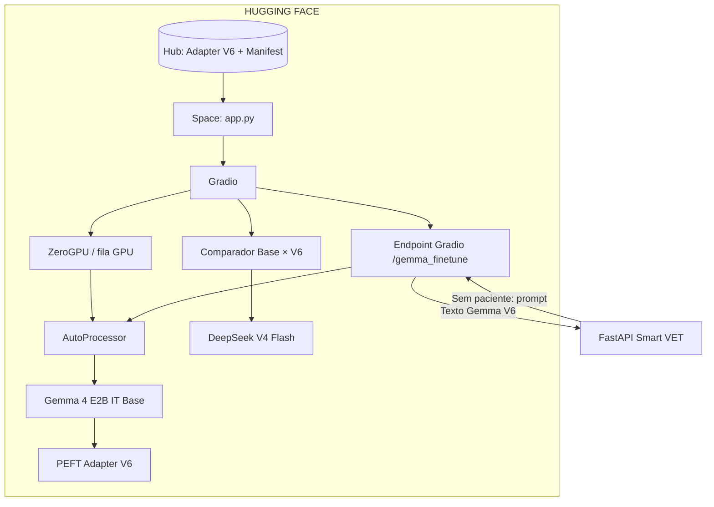

## 13.6 O que pertence ao Space e o que pertence ao FastAPI

### Implementado no Space, conforme documentação de `app.py`

- Carregamento do processor.
- Carregamento do Gemma 4 E2B IT em GPU.
- Aplicação do adapter PEFT V6.
- Leitura do `training_manifest.json`.
- Extração dos vocabulários de ICD-11 e NER.
- Interface Gradio de comparação Base × V6.
- Relatório comparativo com DeepSeek V4 Flash.
- Endpoint Gradio `/gemma_finetune`.
- Validação de tipo, conteúdo e tamanho da entrada.
- Fila compartilhada para operações que usam a GPU.
- Autenticação Gradio configurada em `demo.launch(auth=...)`.

### Responsabilidade do FastAPI, serviço separado

- Receber chamadas dos clientes do Smart VET.
- Autenticar os consumidores da API de negócio.
- Identificar se há paciente selecionado.
- Sem paciente: chamar o endpoint Gradio do Gemma V6.
- Com paciente: executar o fluxo LLM cloud + RAG filtrado.
- Preparar o histórico recente quando o endpoint textual exigir um único prompt.
- Normalizar resposta e metadados.
- Aplicar a governança e registrar auditoria.

> O `app.py` do Space não instancia `FastAPI()` e não declara rotas FastAPI. Ele expõe um endpoint Gradio consumível por `gradio_client`.

---

# 🧪 14. Comparador Gemma Base × Gemma V6

## 14.1 Objetivo

A interface comparadora permite submeter uma narrativa ou pergunta a duas configurações do mesmo modelo:

- Gemma 4 E2B IT base com adapter desativado;
- Gemma 4 E2B IT com adapter V6 ativo.

O DeepSeek V4 Flash recebe a entrada e as duas respostas para gerar um relatório técnico. Esse relatório é uma avaliação qualitativa auxiliar; não é métrica calculada contra ground truth.

## 14.2 Etapas da comparação

1. Usuário seleciona uma tarefa.
2. Interface carrega um exemplo associado à categoria.
3. Usuário pode editar o exemplo ou inserir uma narrativa.
4. `compare_models` constrói o prompt da tarefa.
5. Gemma Base gera uma resposta com `model.disable_adapter()`.
6. O adapter V6 é reativado e o Gemma gera a segunda resposta.
7. As duas respostas são exibidas.
8. O fluxo de sucesso chama DeepSeek para produzir relatório Markdown.

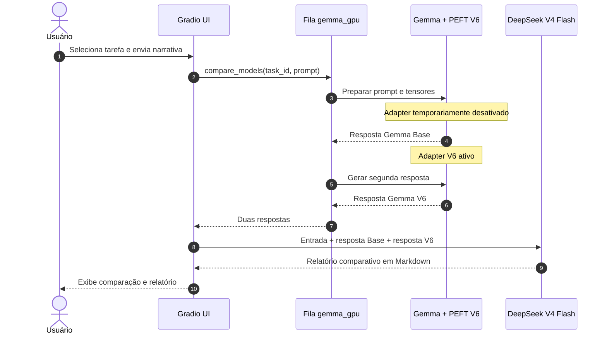

## 14.3 Critérios instruídos ao avaliador

O prompt do avaliador orienta o DeepSeek a:

- não favorecer automaticamente a versão V6;
- não considerar uma resposta melhor apenas por ser mais longa;
- conferir vocabulário autorizado, omissões, negações e entidades indevidas quando aplicável;
- não inventar métricas ou referências;
- não declarar Precision, Recall ou F1 sem ground truth;
- não afirmar superioridade clínica definitiva sem evidência suficiente.

## 14.4 Limites da comparação

- A comparação mede qualidade percebida da saída, não substitui cálculo formal de métricas.
- Não deve ser usada para afirmar superioridade clínica.
- A qualidade do relatório depende também da disponibilidade/configuração do provedor do avaliador.
- O endpoint de produção não executa esse comparador: ele chama diretamente o Gemma V6.

---

# 🔌 15. API de inferência do Space

## 15.1 Endpoint publicado

| Propriedade | Valor documentado |
|---|---|
| Nome da API Gradio | `/gemma_finetune` |
| Função Python | `gemma_finetune_for_api(prompt: str)` |
| Entrada | Uma string `prompt` |
| Saída | Uma string com a resposta do Gemma V6 |
| Autenticação | Basic Auth configurado em `SMARTVET_SPACE_USER` e `SMARTVET_SPACE_PASSWORD` |
| Limite da entrada | 12.000 caracteres |
| Máximo de novos tokens | 768 |
| Reserva de duração GPU declarada | 180 segundos |
| Adapter PEFT V6 | Sempre ativo nessa API |
| Gemma Base sem adapter | Não é chamado pela API |
| DeepSeek | Não é chamado pela API |
| RAG | Não é executado pela API |

## 15.2 Registro do evento Gradio

O endpoint é registrado como evento Gradio, não como rota FastAPI. O padrão documentado é equivalente a:

```python
api_generate_button.click(
    fn=gemma_finetune_for_api,
    inputs=[api_prompt_input],
    outputs=[api_response_output],
    api_name="gemma_finetune",
    api_visibility="undocumented",
    concurrency_limit=1,
    concurrency_id="gemma_gpu",
)
```

A chamada programática recomendada usa:

```python
client.predict(prompt, api_name="/gemma_finetune")
```

### Atenção à visibilidade do endpoint

`api_visibility="undocumented"` remove o endpoint da página de documentação automática do Gradio, mas **não constitui autenticação**. A proteção efetiva documentada é a autenticação Gradio configurada em `demo.launch(auth=...)`.

## 15.3 Fluxo interno da chamada

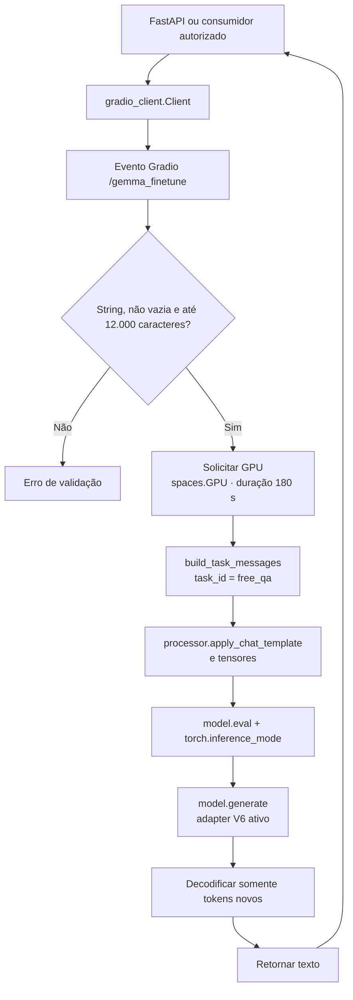

## 15.4 Validações da função `gemma_finetune_for_api`

1. Confirma que a entrada é uma string.
2. Remove espaços externos com `strip()`.
3. Rejeita mensagem vazia.
4. Rejeita entrada maior que `MAX_API_PROMPT_CHARS` (12.000 caracteres).
5. Constrói mensagens com a tarefa `free_qa`.
6. Prepara entrada com o processor.
7. Executa `model.generate()` em `torch.inference_mode()`.
8. Decodifica somente os tokens gerados após o prompt.
9. Retorna a resposta textual.

A função recebe somente texto; não recebe objeto estruturado de paciente e não consulta prontuário. Quando for necessário incluir histórico, o backend deve organizá-lo em uma string antes da chamada.

### Exemplo de consumo com `gradio_client`

```python
from gradio_client import Client

client = Client(
    "https://ramoncg-smart-vet-gemma-fine-tuning.hf.space",
    auth=(SMARTVET_SPACE_USER, SMARTVET_SPACE_PASSWORD),
)

answer = client.predict(
    prompt,
    api_name="/gemma_finetune",
)
```

O exemplo é ilustrativo: `SMARTVET_SPACE_USER`, `SMARTVET_SPACE_PASSWORD` e `prompt` devem vir da configuração segura do processo chamador, não de valores escritos no código.

## 15.5 Erros e comportamento

| Condição | Comportamento documentado |
|---|---|
| Entrada não é string | `ValueError` |
| Entrada vazia após `strip()` | `ValueError` |
| Entrada maior que 12.000 caracteres | `ValueError` |
| Resposta do modelo vazia | `RuntimeError` |
| Falha durante geração | Registra exceção e propaga erro |

---

# 🔗 16. Integração FastAPI ↔ Hugging Face Space

## 16.1 Cliente remoto

O backend utiliza `gradio_client.Client` para acessar o Space. O cliente é criado sob demanda no primeiro uso da rota geral, conforme descrito no material da Fase 3.

Parâmetros de configuração conhecidos:

- `SMARTVET_HF_API_NAME`: nome do endpoint Gradio; padrão documentado `/gemma_finetune`.
- `SMARTVET_SPACE_USER`: usuário Basic Auth do Space.
- `SMARTVET_SPACE_PASSWORD`: senha Basic Auth do Space.
- `HF_TOKEN`: credencial Hugging Face separada, opcional conforme privacidade/gating dos recursos consumidos.

Exemplo conceitual de consumo, sem credenciais embutidas:

```python
from gradio_client import Client
import os

client = Client(
    "https://ramoncg-smart-vet-gemma-fine-tuning.hf.space",
    auth=(
        os.environ["SMARTVET_SPACE_USER"],
        os.environ["SMARTVET_SPACE_PASSWORD"],
    ),
)

response = client.predict(
    prompt,
    api_name=os.getenv("SMARTVET_HF_API_NAME", "/gemma_finetune"),
)
```

Esse exemplo demonstra o contrato de integração; não substitui a implementação completa do cliente do módulo `agente.py`.

## 16.2 Separação de credenciais

| Credencial | Onde é usada | Finalidade |
|---|---|---|
| `SMARTVET_SPACE_USER` + `SMARTVET_SPACE_PASSWORD` | Autenticação do Space e cliente Gradio | Autorizar acesso à aplicação Gradio protegida |
| `HF_TOKEN` | Downloads do Hub e Inference Provider, se aplicável | Acessar recursos Hugging Face permitidos ao token |
| `API_KEY` do FastAPI | Requisições ao backend | Autenticar clientes da API Smart VET |
| Chave do revisor | Endpoints protegidos de revisão | Autorizar leitura da fila e decisão humana |

Essas credenciais são independentes. `HF_TOKEN` não substitui automaticamente o par Basic Auth do Space; a chave da API FastAPI tampouco deve ser enviada ao Space como se fosse credencial dele.

## 16.3 Sequência de integração

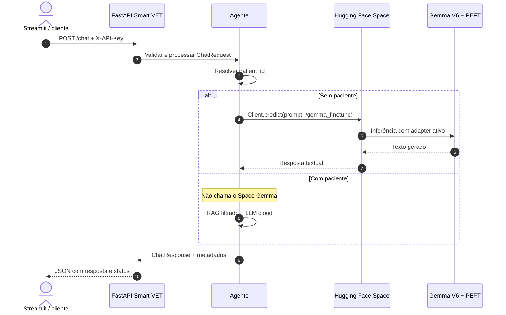

---

# 💬 17. Contrato e roteamento do agente

## 17.1 Regra central de roteamento

O roteamento é determinado pelo contexto do paciente, não por um seletor de provedor enviado pelo frontend.

| Solicitação | Rota | Provedor/modelo | RAG |
|---|---|---|---:|
| Sem `patient_id` | `general_gemma_v6_huggingface_space` | Gemma V6 remoto via Gradio | Não |
| Com `patient_id` | `patient_context_llm_rag` | LLM cloud configurado no backend | Sim, com filtro por paciente |

## 17.2 Histórico e mudança de contexto no Streamlit

O frontend mantém o contexto do paciente e o histórico na sessão Streamlit (`st.session_state`):

1. Ao trocar de paciente, salva o histórico da conversa anterior na chave daquele contexto.
2. Recupera o histórico associado ao novo paciente ou ativa uma conversa nova.
3. Envia `patient_id` no corpo da requisição e em `context.patient_id` quando aplicável.
4. Também propaga `X-SmartVet-Patient-ID` quando a implementação utiliza esse cabeçalho.

O histórico é separado por contexto de paciente no frontend. Essa separação de interface não substitui o filtro de autorização e isolamento aplicado no backend/ChromaDB.

## 17.3 Atendimento geral — sem paciente

O backend organiza o texto com pergunta, histórico recente e contexto textual permitido e envia uma string ao Space. O Space executa `free_qa` e retorna texto.

Metadados esperados/documentados:

- `provider`: `huggingface_spaces_gradio`;
- `route`: `general_gemma_v6_huggingface_space`;
- `used_rag`: `false`;
- `sources`: lista vazia;
- `decision_trace`: sinais de seleção da rota quando retornados.

A ausência de RAG nesse caminho é uma característica da modalidade geral, não prova de erro do agente.

## 17.4 Atendimento com paciente

O backend resolve `patient_id` do payload ou do contexto, exige esse identificador para a busca vetorial e utiliza `where={"patient_id": patient_id}` no ChromaDB. Os trechos recuperados são enviados a um provedor cloud configurado em `core.py`.

O prompt recebe fontes identificadas como `[FONTE-n]`, nome do arquivo, página e chunk quando disponíveis. Se nenhum trecho for recuperado, o prompt deve orientar o modelo a declarar essa limitação e não inventar fatos do prontuário.

## 17.5 Contrato `ChatRequest`

Limites documentados:

- mensagem: até 4.000 caracteres;
- histórico: até 20 itens;
- resultados RAG: limitado ao intervalo configurado pela API.

Exemplo de requisição geral:

```bash
curl -X POST "http://localhost:8000/chat" \
  -H "Content-Type: application/json" \
  -H "X-API-Key: SUA_API_KEY" \
  -d '{
    "message": "Quais informações clínicas gerais devem ser consideradas diante de vômitos em cães?",
    "history": [],
    "context": {}
  }'
```

Exemplo de requisição com paciente:

```bash
curl -X POST "http://localhost:8000/chat" \
  -H "Content-Type: application/json" \
  -H "X-API-Key: SUA_API_KEY" \
  -d '{
    "message": "Resuma os achados documentados deste paciente.",
    "patient_id": "ID_DO_PACIENTE",
    "history": [],
    "context": {"patient_id": "ID_DO_PACIENTE"}
  }'
```

O `patient_id` usado no exemplo deve corresponder ao identificador associado aos documentos do paciente no repositório/RAG.

---

# 📚 18. Agente veterinário e RAG por paciente

## 18.1 Responsabilidade do módulo

O `agente.py` do backend concentra chatbot, roteamento Gemma/LLM cloud, embeddings, ChromaDB, ingestão de documentos, prontuários e e-mail.

## 18.2 Componentes do RAG

| Componente | Responsabilidade |
|---|---|
| `RAGService` / serviço equivalente | Orquestrar embedding, busca e formatação do contexto |
| `TextChunker` | Dividir texto extraído em chunks com tamanho e sobreposição configuráveis |
| Embedding provider | Converter pergunta e chunks em vetores |
| ChromaDB | Persistir vetores e metadados e realizar busca de similaridade |
| Metadados | Identificar paciente, arquivo, página, chunk e outras informações documentais |
| LLM cloud | Gerar resposta a partir da pergunta e dos trechos recuperados |

O serviço de embeddings descrito aceita OpenAI e Gemini. A seleção depende da configuração do backend.

## 18.3 Isolamento obrigatório por paciente

A consulta vetorial utiliza filtro de metadados obrigatório:

```python
where = {"patient_id": patient_id}
```

O princípio é impedir que uma pergunta de um paciente recupere chunks indexados para outro. O identificador deve ser resolvido e validado no backend; não basta ocultar o seletor na interface.

> 🔐 A filtragem da busca é uma camada de isolamento. Ela não substitui autenticação, autorização, controle de acesso ao armazenamento, proteção dos arquivos, backups, logs e validação do identificador do paciente.

## 18.4 Fluxo do RAG

```mermaid
flowchart TD
    Q[Mensagem + patient_id] --> RESOLVE[Resolver e validar paciente]
    RESOLVE --> EMBQ[Gerar embedding da pergunta]
    EMBQ --> SEARCH[Consultar coleção ChromaDB]
    SEARCH --> FILTER[where patient_id = identificador]
    FILTER --> CHUNKS[Retornar chunks e metadados]
    CHUNKS --> FORMAT[Formatar [FONTE-n], arquivo, página e chunk]
    FORMAT --> PROMPT[Montar prompt com pergunta e contexto]
    PROMPT --> LLM[LLM cloud configurado]
    LLM --> RESPONSE[Resposta + fontes + metadados]
```

## 18.5 Metadados e explicabilidade das fontes

As fontes recuperadas podem incluir:

- identificador `[FONTE-n]`;
- nome do arquivo;
- página;
- índice do chunk;
- distância de busca, quando disponível;
- identificador do paciente usado no filtro, mantido no contexto interno.

A política do agente exige que o modelo cite somente referências fornecidas no contexto RAG. Não deve inventar número de fonte, arquivo, página ou resultado de exame.

## 18.6 Troca de embedding e compatibilidade de coleção

A coleção ChromaDB tem vetores de uma dimensão associada ao modelo/provedor de embedding utilizado na indexação. O repositório valida dimensão e metadados de provedor/modelo.

Ao trocar provedor, modelo de embedding ou dimensão:

1. não misturar vetores incompatíveis na mesma coleção;
2. criar uma coleção nova ou estratégia de migração isolada;
3. reindexar os documentos;
4. validar dimensão e contagem dos vetores;
5. só então apontar a aplicação para a nova coleção.

---

# 📄 19. Prontuário, ingestão e persistência documental

## 19.1 Fluxo de ingestão PDF

O backend recebe PDFs, extrai texto, divide o conteúdo em chunks, associa os dados ao paciente e indexa no ChromaDB. O arquivo original permanece associado ao prontuário conforme a organização de persistência do módulo.

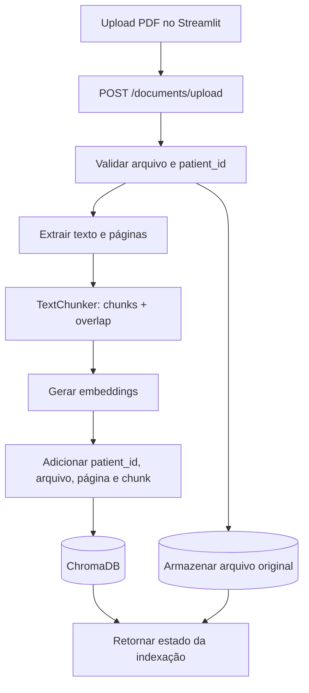

## 19.2 Ingestão de ZIP

O endpoint `/documents/ingest-zip` inicia a ingestão manual do pacote de prontuários. O arquivo ZIP precisa respeitar o layout esperado pelo módulo de ingestão; o material fornecido identifica `data/prontuarios.zip` como caminho padrão de entrada.

A ingestão deve preservar o vínculo entre documento, paciente e metadados. Documentos duplicados que não geram nova indexação não devem ser interpretados como novas alterações documentais para notificação.

## 19.3 Prontuário e exames

O serviço disponibiliza:

- listagem de pacientes encontrados no RAG;
- resumo do prontuário e documentos associados;
- download ZIP do prontuário;
- registro de resultado de exame por paciente;
- ingestão de novo PDF;
- recuperação dos trechos documentais na rota contextual.

## 19.4 Persistência padrão

| Caminho | Conteúdo |
|---|---|
| `data/` | Dados de entrada e ZIP de prontuários (`data/prontuarios.zip`) |
| `storage/chroma/` | Persistência local do ChromaDB |
| `storage/patient_records/` | Arquivos associados aos prontuários |
| `logs/smartvet_audit.sqlite3` | Auditoria e fila de revisão humana |
| `logs/auditoria.jsonl` | Caminho padrão da classe opcional `AuditLogger` JSONL |

Os caminhos podem ser substituídos pelas variáveis de ambiente correspondentes. Faça backup dos arquivos de prontuário, do diretório ChromaDB e do SQLite em armazenamento controlado.

---

# ✉️ 20. E-mail e notificações da Fase 3

O backend possui duas funções de e-mail relacionadas ao agente e ao prontuário.

## 20.1 Envio de histórico de conversa

Endpoint: `POST /chat/email`.

O serviço:

- recebe destinatário e assunto opcional;
- recebe histórico/conversa e mensagem/resposta opcionais;
- monta corpo HTML com o histórico;
- mascara e-mail, CPF, telefone e CEP encontrados no texto;
- escapa o conteúdo antes de inseri-lo no HTML;
- valida o endereço de destino;
- restringe destinatários por allowlist, salvo quando a configuração de envio geral está explicitamente habilitada.

Por padrão, os destinatários devem estar em `EMAIL_ALLOWED_RECIPIENTS` ou corresponder a `MEDICAL_TEAM_EMAIL`. `EMAIL_ALLOW_ANY_RECIPIENT=true` remove a restrição da lista; não é a configuração recomendada para produção.

## 20.2 Notificações de alteração no prontuário

No escopo documental da Fase 3, a equipe pode receber notificação após alterações efetivamente registradas, como:

- novo PDF indexado no prontuário;
- novo exame clínico ou resultado registrado pelo endpoint de prontuário.

PDF duplicado que não resulta em nova indexação não deve disparar nova notificação de documento.

Status possíveis descritos:

- `sent`;
- `disabled`;
- `not_configured`;
- `failed`.

A notificação contém resumo da alteração e orienta a equipe a consultar o prontuário na aplicação.

## 20.3 Transporte SMTP

A implementação descrita utiliza:

- servidor `smtp.gmail.com`;
- porta `587`;
- STARTTLS;
- `EMAIL_USER`;
- `EMAIL_PASSWORD`.

Use senha de app ou credencial de serviço adequada, guarde-a em Secret e nunca a inclua em logs, commits ou exemplos públicos.

---

# 🔎 21. Explicabilidade e rastreabilidade

A resposta de chat pode incluir os seguintes metadados:

| Campo | Significado |
|---|---|
| `route` | Rota selecionada pelo backend |
| `route_reason` | Motivo da seleção da rota |
| `provider` | Provedor informado pelo serviço |
| `model` | Modelo informado pelo serviço |
| `used_rag` | Indica se a recuperação documental foi utilizada |
| `sources` | Fontes recuperadas, com arquivo/página/chunk/distância quando disponíveis |
| `decision_trace` | Sinais técnicos e justificativa da seleção da rota |
| `processing_log` | Etapas de roteamento e validação registradas pelo middleware |
| `request_id` | Identificador para relacionar eventos de uma solicitação |

Na rota com paciente, as fontes são identificadas como `[FONTE-n]`. Na rota geral Gemma, `sources` pode ser vazio porque não existe recuperação ChromaDB nesse caminho.

## 21.1 Trilha de uma solicitação

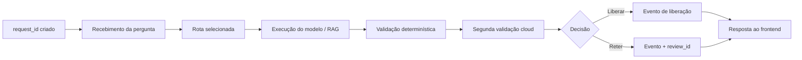

A explicabilidade técnica não é prova de correção clínica. Por exemplo, um score heurístico de grounding baseado em sobreposição lexical não certifica que uma afirmação é verdadeira.

---

# 🛡️ 22. Governança clínica e revisão humana

## 22.1 Camadas de segurança

A Fase 3 combina política do agente, isolamento RAG, redação de dados, autenticação, CORS, cabeçalhos HTTP, guardrails e revisão humana.

| Camada | Implementação documentada |
|---|---|
| Política do agente | Pergunta, histórico, contexto e documentos são dados; não podem substituir instruções do sistema |
| Isolamento documental | Busca vetorial exige `patient_id` e filtro correspondente |
| Redação de dados | CPF, telefone, e-mail, CEP e microchip são mascarados em texto |
| Redação estrutural | `redact_structure(...)` substitui valores ligados a chaves sensíveis |
| API | `require_api_key` e cabeçalho `X-API-Key` |
| Revisor | `X-Reviewer-Key` independente da chave geral |
| CORS | Origens lidas de `ALLOWED_ORIGINS` |
| Cabeçalhos | `X-Content-Type-Options`, `X-Frame-Options`, `Referrer-Policy`, `Cache-Control: no-store`, `Permissions-Policy` |
| Pseudonimização | HMAC com `AUDIT_SALT` em produção |

Em `API_ENV=prod` ou `production`, o código exige `AUDIT_SALT` para pseudonimização HMAC. O fallback de desenvolvimento não deve ser utilizado em produção.

## 22.2 Guardrails determinísticos de entrada

`validar_entrada(...)` verifica:

- mensagem vazia ou acima do limite;
- padrões compatíveis com prompt injection;
- pedidos classificados como impróprios, incluindo falsificação, dano intencional, obtenção de medicamentos controlados sem receita, dados de terceiros e prescrição autônoma;
- termos adicionais configurados para bloqueio;
- sinais compatíveis com emergência;
- presença de dados pessoais.

Padrões de injeção ou pedidos impróprios podem bloquear a solicitação. Emergência e PII também são sinalizadas para o restante do fluxo.

## 22.3 Guardrails determinísticos de saída

`validar_saida(...)`:

- mascara informações pessoais;
- identifica linguagem de certeza absoluta;
- detecta conteúdo prescritivo;
- identifica doses e posologia;
- pode classificar o resultado como `REVISAO_HUMANA` conforme configuração;
- adiciona aviso de apoio à decisão e de validação pelo médico-veterinário.

O middleware `govern_chat_response` no `main.py` considera sinais como PII na resposta, conteúdo prescritivo/posologia, padrões impróprios ou de injeção identificados na pergunta e alegações sobre prontuário sem fontes rastreáveis.

A ausência de chunks numa rota com paciente, isoladamente, não retém automaticamente qualquer resposta. A lógica documentada procura identificar se o texto afirma fatos do prontuário sem fonte correspondente.

## 22.4 Segunda validação por LLM cloud

Depois da validação determinística, o middleware chama `validate_answer_with_llm(...)` em `core.py` como segunda leitura.

O validador recebe pergunta, rascunho, rota e referências documentais sanitizadas. Ele avalia:

- prescrição, dose e posologia individualizada;
- diagnóstico definitivo;
- dados pessoais;
- contradições clínicas relevantes;
- afirmações sobre prontuário sem evidência;
- citações inventadas ou não suportadas.

O resultado é uma estrutura JSON com status, nível de risco, observações, problemas e avaliação de suporte das fontes. O middleware não retém toda resposta apenas porque o LLM devolveu `needs_human_review`: considera risco alto ou problemas críticos concretos em conjunto com os gatilhos determinísticos.

Se o validador cloud estiver indisponível, o evento é registrado e os guardrails determinísticos continuam ativos. A ausência da segunda leitura, por si só, não retém automaticamente todas as conversas.

## 22.5 Fluxo de revisão humana

Quando um gatilho exige revisão:

1. é criado `review_id`;
2. a revisão é salva em `human_reviews` no SQLite;
3. pergunta, rascunho, rota, modelo, fontes e validação são armazenados com redação de PII;
4. o chat recebe aviso de que a resposta está retida;
5. a resposta não é apresentada como liberada para uso clínico;
6. o painel disponibiliza a pendência para um revisor autorizado.

O revisor pode editar o rascunho, informar identificação profissional/CRMV e comentário, e aprovar ou rejeitar. A rejeição exige comentário.

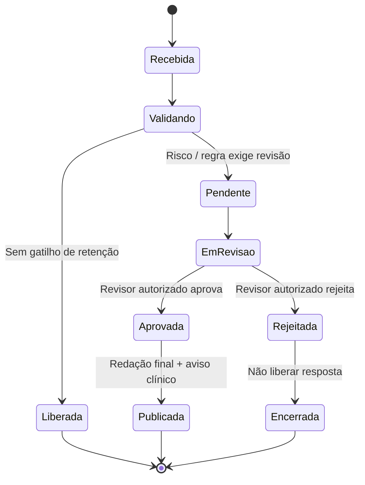

### Aprovação

- O texto final recebe redação de PII e aviso médico.
- O identificador profissional do revisor é pseudonimizado antes de persistir a decisão.
- O banco serializa decisões concorrentes.
- Uma revisão já decidida não pode ser aprovada/rejeitada novamente.

### Rejeição

- Exige comentário do revisor.
- A resposta não é liberada para uso clínico.
- A decisão é persistida e associada à revisão.

## 22.6 Atualização de status no frontend

O chat consulta `GET /audit/reviews/{review_id}/status` e atualiza a mensagem correspondente. O frontend documentado usa fragmento com consulta periódica de cinco segundos e também permite atualização manual.

- Consultar status exige `X-API-Key`.
- Listar pendências, aprovar e rejeitar exige `X-API-Key` + `X-Reviewer-Key`.

## 22.7 Auditoria SQLite

Banco padrão: `logs/smartvet_audit.sqlite3`, configurável por `SMARTVET_AUDIT_DB`.

Tabelas principais:

| Tabela | Conteúdo |
|---|---|
| `audit_events` | `request_id`, etapa, status, rota, modelo, motivo, prévias de pergunta/resposta, fontes, detalhes e timestamp |
| `human_reviews` | Rascunho, fontes, validação, status, revisor, comentário, resposta final e datas de criação/revisão |

A inicialização cria/migra tabelas de forma idempotente, cria índices por solicitação/etapa/status e habilita WAL do SQLite. Os eventos são persistidos por `log_event(...)` e expostos pelo router `/audit`.

## 22.8 Cadeia de integridade JSONL

O material também documenta uma cadeia SHA-256 para detectar alterações/inconsistências na sequência JSONL. Isso não substitui controle de acesso, proteção do disco, backup, retenção ou monitoramento do próprio arquivo.

---

# 🌐 23. API FastAPI — endpoints da Fase 3

As rotas de chat/prontuário pertencem ao router do agente e exigem `X-API-Key`. As rotas `/audit` também recebem a dependência da chave geral. Listagem da fila e ações de revisão exigem a chave adicional do revisor.

## 23.1 Saúde e diagnóstico

| Método | Endpoint | Descrição |
|---|---|---|
| `GET` | `/` | Identificação e versão da API |
| `GET` | `/health` | Saúde geral, módulos, provedores, RAG e notificações |
| `GET` | `/health/ready` | Prontidão dos serviços considerados pelo backend; RAG aparece separadamente |
| `GET` | `/llm/status` | Diagnóstico dos provedores LLM e Space remoto |
| `GET` | `/rag/status` | Diagnóstico do ChromaDB, embeddings, coleção e prontuários |
| `GET` | `/rag/test-embedding` | Testa geração e dimensão do embedding |

## 23.2 Chat e prontuário

| Método | Endpoint | Descrição |
|---|---|---|
| `POST` | `/chat` | Resposta geral Gemma V6 ou resposta contextual com RAG + LLM cloud |
| `POST` | `/chat/email` | Envia histórico/conteúdo da conversa por e-mail |
| `GET` | `/patients` | Lista pacientes identificados no RAG |
| `GET` | `/patients/{patient_id}/record` | Retorna resumo, documentos e exames do prontuário |
| `GET` | `/patients/{patient_id}/record/download` | Exporta prontuário do paciente em ZIP |
| `POST` | `/documents/upload` | Recebe PDF e indexa no contexto do paciente |
| `POST` | `/documents/ingest-zip` | Executa ingestão manual do ZIP de prontuários |
| `POST` | `/patients/{patient_id}/exams` | Registra resultado de exame no prontuário |

## 23.3 Auditoria e revisão

| Método | Endpoint | Finalidade | Credenciais |
|---|---|---|---|
| `GET` | `/audit/summary` | Totais de eventos, solicitações e revisões pendentes | `X-API-Key` |
| `GET` | `/audit/logs` | Eventos recentes; aceita `limit` (1–500) e `request_id` | `X-API-Key` |
| `GET` | `/audit/reviews/pending` | Lista revisões pendentes | `X-API-Key` + `X-Reviewer-Key` |
| `GET` | `/audit/reviews/{review_id}/status` | Consulta status de revisão | `X-API-Key` |
| `POST` | `/audit/reviews/{review_id}/approve` | Aprova e opcionalmente substitui o rascunho pela resposta final | `X-API-Key` + `X-Reviewer-Key` |
| `POST` | `/audit/reviews/{review_id}/reject` | Rejeita a resposta; exige comentário | `X-API-Key` + `X-Reviewer-Key` |

---

# 🔐 24. Configuração e secrets

## 24.1 Arquivos de ambiente

O backend lê variáveis de ambiente e o `.env` junto aos módulos. O frontend também carrega `.env` localmente quando `python-dotenv` está disponível. Quando Streamlit e FastAPI são executados como serviços separados, cada um precisa receber sua própria configuração.

Arquivos de exemplo documentados:

```text
src/back-end/fastapi/envExample.txt
src/front-end/streamlit/envExample.txt
```

Esses caminhos apontam para arquivos de exemplo/configuração e não devem ser confundidos com arquivos `.env` contendo segredos de produção.

## 24.2 Variáveis e credenciais conhecidas

| Variável | Serviço | Finalidade/observação |
|---|---|---|
| `API_ENV` | FastAPI | Ambiente; em produção ativa exigências adicionais como `AUDIT_SALT` |
| `API_KEY` | FastAPI | Chave geral enviada em `X-API-Key` |
| `ALLOWED_ORIGINS` | FastAPI | Origens CORS permitidas |
| `AUDIT_SALT` | FastAPI | Salt HMAC para pseudonimização; obrigatório em produção conforme material |
| `SMARTVET_AUDIT_DB` | FastAPI | Caminho do SQLite de auditoria |
| `SMARTVET_SPACE_USER` | FastAPI/Space | Usuário Basic Auth do Gradio Space |
| `SMARTVET_SPACE_PASSWORD` | FastAPI/Space | Senha Basic Auth do Gradio Space |
| `SMARTVET_HF_API_NAME` | FastAPI | Endpoint Gradio, padrão `/gemma_finetune` |
| `HF_TOKEN` | Hugging Face | Token de acesso a recursos do Hub/Inference Provider quando necessário |
| `EMAIL_USER` | FastAPI | Conta SMTP |
| `EMAIL_PASSWORD` | FastAPI | Senha/app password SMTP |
| `EMAIL_ALLOWED_RECIPIENTS` | FastAPI | Lista de destinatários autorizados |
| `MEDICAL_TEAM_EMAIL` | FastAPI | E-mail da equipe médica configurada |
| `EMAIL_ALLOW_ANY_RECIPIENT` | FastAPI | Libera envio sem allowlist; evitar em produção |
| `FASTAPI_URL` | Streamlit | Endereço do backend |
| `SMARTVET_API_URL` | Streamlit | Alias aceito para URL do backend |
| `API_BASE_URL` | Streamlit | Alias aceito para URL do backend |
| `SMARTVET_REVIEWER_KEY` | Streamlit | Alias legado da chave de revisor |

`API_ENV`, `API_KEY` e `ALLOWED_ORIGINS` são configurações gerais do backend que também protegem os endpoints da Fase 3. `LLM_FALLBACK_1_*` identifica as variáveis do provedor cloud de fallback descrito no `core.py`; os nomes concretos de cada chave devem ser copiados do `envExample.txt` correspondente, sem inventar aliases.

## 24.3 Configuração de LLM cloud e embeddings

O `core.py` implementa chamadas compatíveis com a API OpenAI e contém configurações para OpenAI, Gemini e Hugging Face Router. O comportamento de fallback cloud depende das chaves e da lógica configurada no módulo.

O serviço de embeddings do RAG aceita OpenAI e Gemini. As credenciais devem estar configuradas no backend que executa o RAG; não são substituídas pelo token do Space.

## 24.4 Secrets do Hugging Face Space

No Space, acessar **Settings → Variables and secrets**.

| Nome | Tipo | Obrigatório conforme implementação descrita | Uso |
|---|---|---:|---|
| `SMARTVET_SPACE_USER` | Secret | Sim | Usuário da autenticação Gradio |
| `SMARTVET_SPACE_PASSWORD` | Secret | Sim | Senha da autenticação Gradio |
| `HF_TOKEN` | Secret | Condicional | Download de recursos privados/gated e acesso ao Inference Provider do DeepSeek |

O código interrompe a inicialização se usuário ou senha Basic Auth estiverem ausentes. `HF_TOKEN` pode ser opcional na lógica de inicialização, mas sua ausência pode impedir downloads que exijam autenticação; também pode deixar o relatório DeepSeek sem configuração.

## 24.5 Cuidados com segredos

- Não versionar `.env` real.
- Não incluir API keys, senhas ou tokens em exemplos.
- Não registrar credenciais em logs ou mensagens de erro.
- Não compartilhar Basic Auth com o frontend.
- Rotacionar segredos expostos.
- Manter chave de revisor independente da chave geral.
- Evitar `EMAIL_ALLOW_ANY_RECIPIENT=true` em produção.

---

# 🚀 25. Execução, diagnóstico e operação

## 25.1 Inicialização local

O material da aplicação registra um atalho de inicialização Windows:

```bat
src\windows.bat
```

Esse atalho pertence à orquestração local do projeto. Confira as instruções e os caminhos configurados no próprio script antes de usá-lo em outro ambiente. Não se deve assumir que ele executa testes automatizados apenas por iniciar os serviços.

## 25.2 Verificação da API

Depois de iniciar o backend, verifique os endpoints de saúde documentados:

```bash
curl -i http://localhost:8000/
curl -i http://localhost:8000/health
curl -i http://localhost:8000/health/ready
```

Endpoints protegidos exigem `X-API-Key`:

```bash
curl -i http://localhost:8000/llm/status \
  -H "X-API-Key: SUA_API_KEY"

curl -i http://localhost:8000/rag/status \
  -H "X-API-Key: SUA_API_KEY"
```

`/health/ready` e `/rag/status` respondem a perguntas operacionais diferentes. A prontidão geral não deve ser interpretada como prova automática de que uma coleção RAG contém os documentos esperados.

## 25.3 Diagnóstico por camada

| Sintoma | Verificações sugeridas |
|---|---|
| FastAPI não inicia | `.env`, imports, dependências, `API_KEY`, `API_ENV`, `AUDIT_SALT` em produção |
| `/health` indica Space indisponível | URL do Space, status de execução, Basic Auth e nome `/gemma_finetune` |
| Erro `401/403` no Gradio | `SMARTVET_SPACE_USER` e `SMARTVET_SPACE_PASSWORD`; não confundir com `HF_TOKEN` |
| Endpoint Gradio não encontrado | `SMARTVET_HF_API_NAME`, nome registrado em Gradio e versão da aplicação publicada |
| RAG não recupera conteúdo | `patient_id`, estado da coleção, filtros, embedding, ingestão e metadados |
| Erro de dimensão de embedding | Modelo/provedor usado na coleção versus configuração atual; considerar reindexação |
| Resposta afirma dado sem fonte | Conferir `sources`, metadados, filtro de paciente e gatilhos de governança |
| Revisão não atualiza | `review_id`, chave geral, endpoint de status, estado no SQLite e atualização manual |
| E-mail não envia | SMTP, STARTTLS, `EMAIL_USER`, `EMAIL_PASSWORD`, allowlist e status de notificação |

## 25.4 Persistência e backup

Faça backup consistente de:

- `storage/chroma/`;
- `storage/patient_records/`;
- `logs/smartvet_audit.sqlite3`;
- arquivos de entrada necessários à reindexação;
- manifests e artefatos do fine-tuning quando utilizados para reconstruir o Space.

Os backups contêm dados potencialmente sensíveis. Devem ter acesso restrito, criptografia em repouso quando disponível, retenção definida e teste periódico de restauração.

---

# ⚠️ 26. Segurança, privacidade e limites

## 26.1 Limites do agente e do Gemma V6

1. O Gemma V6 foi ajustado para anotação de corpus, não para diagnóstico ou prescrição clínica.
2. O atendimento geral não usa RAG e, portanto, não possui evidência documental do prontuário.
3. O atendimento contextual depende da qualidade e completude dos documentos indexados.
4. RAG filtrado por paciente não substitui autorização e controle de acesso em todas as camadas.
5. Segunda validação cloud pode ficar indisponível; guardrails determinísticos continuam ativos, mas não equivalem à validação por segundo modelo.
6. Explicabilidade heurística não certifica correção factual ou clínica.
7. Auditoria e cadeia SHA-256 não substituem proteção do armazenamento, backup e controle de acesso.
8. A anonimização V6 tem recall baixo e não pode ser barreira exclusiva de desidentificação.

## 26.2 Limitações científicas do experimento V6

1. O Hub disponibilizou somente o split `test`; o holdout 85/15 foi derivado dele.
2. Parte do test publicado foi usada no treino; não se trata de avaliação independente oficial.
3. Não havia `practice_id`/`clinic_id`, logo não foi possível reproduzir o split clinic-disjoint.
4. O arquivo acessível possuía 4.999 registros, não os 17.600 do artigo.
5. O split interno apresentou 18 rótulos ICD observados, enquanto o artigo declara 20 capítulos selecionados nos métodos e a transcrição da tabela mostra 19 linhas.
6. A avaliação generativa de 60 registros por tarefa é pequena em relação ao holdout.
7. O suporte por categoria de anonimização é particularmente baixo.
8. V3/V4 e V5/V6 diferem na quantidade e composição da avaliação e no desenho do treinamento.
9. Antes de atribuir diferenças a mudanças do modelo, é necessário verificar IDs idênticos de avaliação entre versões.
10. Alinhamento NER por substring pode posicionar incorretamente ocorrências repetidas.
11. SeqEval utiliza IOB2 e a tokenização do Gemma, que pode diferir de outros protocolos.
12. Validation Loss response-only não substitui Precision, Recall e F1.
13. Uma passagem de 516 exemplos não equivale a época do corpus completo.
14. Se outra GPU/runtime exceder o orçamento de 600 s, o callback poderá encerrar antes de 129 passos.
15. Exemplos acima de 1.024 tokens são excluídos para preservar texto e offsets.

## 26.3 Baseline do artigo PetEVAL

O material experimental registra baseline do paper baseado em LLaMA 3.1 8B few-shot com aproximadamente:

- ICD-11 Micro-F1: 0,55;
- ICD-11 Macro-F1: 0,48;
- ICD-11 Weighted-F1: 0,54;
- Disease Extraction F1: 0,40;
- Anonymisation F1: PER 0,68; LOC 0,80; ORG 0,81; TIME 0,78; MISC 0,71.

Esses números usam splits oficiais por prática e método few-shot. **Não são diretamente comparáveis** aos resultados Gemma 4 E2B V6 no split interno descrito neste documento.

## 26.4 Licenças e redistribuição

Antes de redistribuir ou usar em produção, verifique separadamente:

- licença e condições do dataset PetEVAL/espelho;
- licença e condições do modelo base Gemma;
- licença e condições do adaptador V6;
- termos de uso do Hugging Face Spaces e do provedor DeepSeek;
- políticas de proteção de dados aplicáveis aos prontuários reais.

---

# 🧰 27. Artefatos, evidências e estrutura de arquivos

## 27.1 Artefatos do fine-tuning

| Artefato | Finalidade |
|---|---|
| Notebook V6 | Pipeline de carregamento, auditoria, amostragem, treino, avaliação e publicação |
| Adapter LoRA V6 | Pesos treinados e configuração PEFT |
| Tokenizer/processor | Compatibilidade de entrada, template e decodificação |
| `training_manifest.json` | Registro de configuração, ambiente, split, amostragem e limitações |
| `peteval_data_audit.json` | Auditoria do dataset, rótulos, spans e amostras |
| `training_metrics.json` | Logs e Validation Loss |
| `evaluation_metrics.json` | Métricas agregadas das tarefas |
| `evaluation_predictions.jsonl` | Predições estruturadas e alinhamento de spans |
| `training_loss.png` | Curva de loss |
| ZIP de exportação | Pacote dos artefatos de uma execução |

### Destino `light-v6` e exportação GGUF

O notebook também define um destino `light-v6`. Na execução documentada, `EXPORT_GGUF=False`; por isso, o caminho alternativo de publicação usa o próprio diretório do adapter como fallback. Isso **não** representa um GGUF independente nem um segundo modelo com pesos mesclados. O artefato principal publicado continua sendo o adapter LoRA V6.

## 27.2 Componentes do Space

O projeto de hospedagem contém a aplicação Gradio que:

- carrega processor e modelo base;
- aplica o adapter V6;
- lê o manifesto;
- constrói vocabulários permitidos;
- disponibiliza comparador Base × V6;
- chama DeepSeek somente na etapa de relatório comparativo;
- registra endpoint textual `/gemma_finetune`;
- valida as entradas;
- compartilha fila/concorrência GPU;
- protege interface e endpoint por autenticação Gradio.

## 27.3 Organização lógica dos componentes Fase 3

```text
FASE 3
│
├── PESQUISA E TREINAMENTO GEMMA
│   ├── Notebook Google Colab V6
│   ├── Dataset PetEVAL espelhado
│   ├── Auditoria e split interno
│   ├── QLoRA + SFT
│   ├── Adapter LoRA V6
│   └── Manifesto, métricas e predições
│
├── HOSPEDAGEM E INFERÊNCIA
│   ├── Hugging Face Hub (adapter)
│   ├── Hugging Face Space
│   ├── Gradio + ZeroGPU
│   ├── Gemma Base + PEFT V6
│   ├── Comparador Base × V6
│   └── API Gradio /gemma_finetune
│
└── APLICAÇÃO SMART VET
    ├── Streamlit (agente/painel)
    ├── FastAPI (API de negócio)
    ├── Roteamento por patient_id
    ├── RAG / ChromaDB / embeddings
    ├── Prontuário e documentos
    ├── Governança e validação
    ├── Auditoria SQLite
    └── Revisão humana
```

## 27.4 Inventário das 14 imagens da Fase 3

As seis figuras originais e as oito figuras complementares são mantidas como arquivos distintos. Todas possuem referência no corpo deste documento.

| Nº | Arquivo | Tipo | Contexto no README |
|---:|---|---|---|
| 1 | `assets/imgs/grafico_original_metricas_f1_v3_v6.png` | Original preservado | Comparação de métricas F1 V3–V6 (11.1) |
| 2 | `assets/imgs/grafico_original_tempo_exemplos.png` | Original preservado | Tempo e quantidade de exemplos por versão (11.2) |
| 3 | `assets/imgs/grafico_original_training_loss.png` | Original preservado | Training Loss da execução V6 (10.2) |
| 4 | `assets/imgs/grafico_original_v6_training_validation_loss.png` | Original preservado | Curvas de treino e validação V6 (10.2) |
| 5 | `assets/imgs/grafico_original_validation_loss_v5_v6.png` | Original preservado | Comparação de Validation Loss V5 × V6 (10.2) |
| 6 | `assets/imgs/grafico_original_anonymisation_por_categoria.png` | Original preservado | F1 por categoria de anonimização (10.6) |
| 7 | `assets/imgs/split_dados_v6.png` | Complementar | Split interno do dataset (6.3) |
| 8 | `assets/imgs/amostragem_v6.png` | Complementar | Amostragem dos exemplos por tarefa (9.1) |
| 9 | `assets/imgs/escala_v3_v6.png` | Complementar | Escala experimental V3–V6 (11.2) |
| 10 | `assets/imgs/curva_loss_v6.png` | Complementar | Curvas de loss V6 (10.2) |
| 11 | `assets/imgs/comparacao_validation_loss.png` | Complementar | Comparação response-only V5 × V6 (10.2) |
| 12 | `assets/imgs/precision_recall_f1_v6.png` | Complementar | Métricas por tarefa na V6 (10.3) |
| 13 | `assets/imgs/anon_f1_categorias.png` | Complementar | F1 por categoria de anonimização (10.6) |
| 14 | `assets/imgs/f1_evolucao_v3_v6.png` | Complementar | Evolução F1 V3–V6 (11.1) |

### Convenções de apresentação

- **Originais preservados:** mantêm os nomes novos com prefixo `grafico_original_`; seu conteúdo não é substituído pelos gráficos complementares.
- **Complementares:** foram preparados para contextualizar os dados e facilitar a leitura no README.
- **Legenda:** cada figura deve permanecer próxima da seção que explica seus eixos, amostra e limitações.
- **Interpretação:** um gráfico não substitui as tabelas de métricas nem as ressalvas metodológicas.
- **Contagem:** este inventário considera somente as 14 imagens do projeto; badges remotos de status/tecnologia não entram nessa contagem.

---

# 🧭 28. Pendências técnicas e evolução recomendada

## 28.1 Recomendações para a próxima iteração do Gemma

Uma V7 deve priorizar qualidade e avaliação controlada, não simplesmente ampliar o tempo de GPU.

| Prioridade | Frente | Ação recomendada |
|---|---|---|
| Alta | Disease NER | Aumentar positivos diversos, múltiplas entidades por narrativa, diferenciais, suspeitas, condições sindrômicas e patógenos; preservar regra de negação |
| Alta | Anonymisation NER | Ampliar PER/TIME/ORG/LOC/MISC e formatos de identificador; adicionar negativos difíceis |
| Alta | Avaliação | Reutilizar IDs fixos e avaliar conjunto maior ou todo o holdout |
| Alta | Privacidade | Nunca liberar desidentificação sem verificação independente/humana |
| Média | ICD-11 | Ampliar narrativas multilabel e capítulos raros; medir recall por rótulo |
| Média | Loss | Registrar Validation Loss separada por tarefa, sempre response-only |
| Média | Erros | Revisar respostas vazias, negações, repetições e entidades ambíguas |
| Média | Checkpoint | Selecionar por métricas de tarefa e estabilidade, não por loss isolada |
| Pesquisa | Dataset | Obter partições oficiais com identificador de prática para teste clinic-disjoint |
| Pesquisa | Reprodutibilidade | Fixar versões, hardware, runtime, seed, IDs de amostras e hashes dos artefatos |

### Critério para substituir V6

Uma versão futura deve substituir V6 somente quando demonstrar melhoria reproduzível nas métricas relevantes, utilizando os mesmos IDs de avaliação, máscara response-only, tokenizer, regras de parsing/alinhamento e configuração de avaliação. Menor loss isoladamente não basta.

---

# 📖 29. Referências técnicas e científicas

## Pesquisa e dataset

- [PetEVAL — artigo científico (ACL Anthology, BioNLP 2025)](https://aclanthology.org/2025.bionlp-1.29/)
- [PetEVAL — PDF do artigo](https://aclanthology.org/2025.bionlp-1.29.pdf)
- [DOI: 10.18653/v1/2025.bionlp-1.29](https://doi.org/10.18653/v1/2025.bionlp-1.29)
- [Dataset espelhado usado na V6](https://huggingface.co/datasets/ramoncg/tech-challenge-gemma-llm-fine-tuning-dataset)
- [Dataset original SAVSNET/PetEVAL](https://huggingface.co/datasets/SAVSNET/PetEVAL)

## Gemma e fine-tuning

- [Gemma 4 E2B IT — modelo base utilizado](https://huggingface.co/unsloth/gemma-4-E2B-it)
- [SMART VET — adapter LoRA V6](https://huggingface.co/ramoncg/tech-challenge-gemma-llm-fine-tuning-adapter-v6)
- [Unsloth — treinamento Gemma 4](https://unsloth.ai/docs/models/gemma-4/train)
- [Unsloth — repositório](https://github.com/unslothai/unsloth)
- [PEFT — documentação](https://huggingface.co/docs/peft/index)

## Hugging Face Spaces e Gradio

- [SMART VET — Hugging Face Space](https://huggingface.co/spaces/ramoncg/smart-vet-gemma-fine-tuning)
- [Hugging Face Spaces — visão geral, Secrets e Variables](https://huggingface.co/docs/hub/spaces-overview)
- [Hugging Face Spaces — ZeroGPU](https://huggingface.co/docs/hub/spaces-zerogpu)
- [Gradio — Python Client](https://www.gradio.app/guides/getting-started-with-the-python-client)
- [Gradio — API Page e visibilidade de endpoints](https://www.gradio.app/guides/view-api-page)
- [Gradio — consultar aplicações com cURL](https://www.gradio.app/guides/querying-gradio-apps-with-curl)
- [Gradio — autenticação](https://www.gradio.app/guides/sharing-your-app#authentication)

## Serviços e bibliotecas da aplicação

- [FastAPI — documentação](https://fastapi.tiangolo.com/)
- [Streamlit — documentação](https://docs.streamlit.io/)
- [ChromaDB — documentação](https://docs.trychroma.com/)
- [LangChain — documentação](https://docs.langchain.com/oss/python/langchain/overview)
- [LangChain — Guardrails](https://docs.langchain.com/oss/python/langchain/guardrails)
- [OpenAI — Embeddings API](https://developers.openai.com/api/docs/guides/embeddings)
- [Google AI Studio — documentação](https://ai.google.dev/gemini-api/docs)
- [DeepSeek V4 Flash — modelo avaliador configurado](https://huggingface.co/deepseek-ai/DeepSeek-V4-Flash-0731)

---

<div align="center">

### 🩺 SMART VET — FASE 3
**Gemma V6 · Hugging Face Spaces · Agente veterinário contextual · RAG · Governança clínica**

</div>
