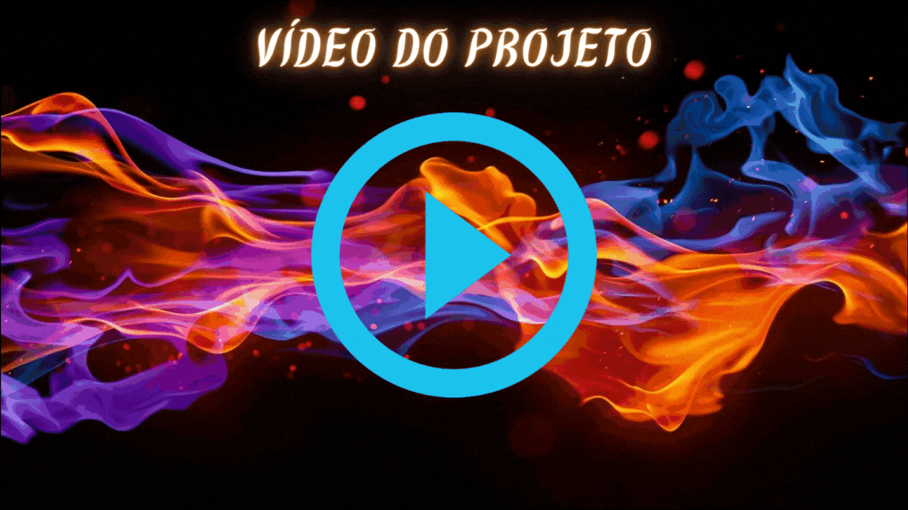
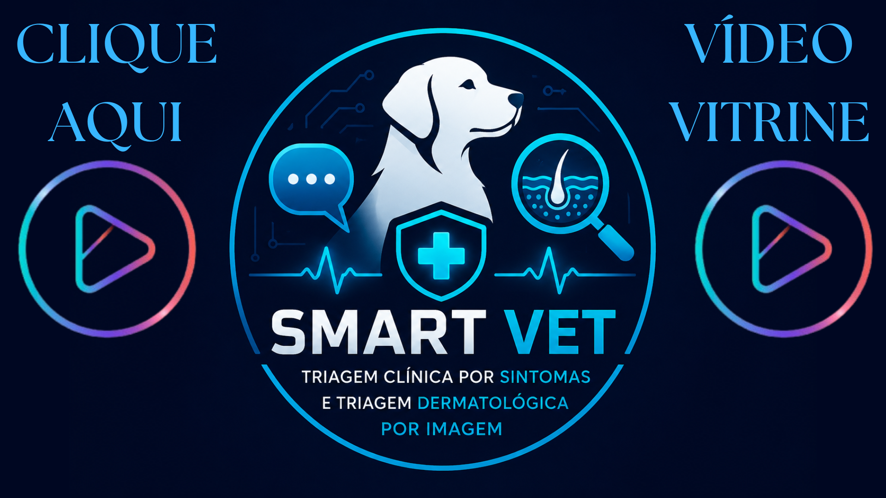

# ⚡ SmartVET – Sistema Inteligente de Apoio à Triagem Veterinária

Documentação e evolução do projeto divididas em fases.

Cada etapa do projeto está organizada em arquivos separados para facilitar a navegação e o acompanhamento da evolução.

## 🏁 Fases

- [Fase 1](./FASE1.MD) — Disponível
- [Fase 2](./FASE2.MD) — Disponível
- [Fase 3](./FASE3.MD) — Disponível

# 🖥️ Endpoints

* 🌐 [Smart VET huggingface Spaces](https://huggingface.co/spaces/ramoncg/smart-vet-gemma-fine-tuning)
>Compare o Gemma 4 E2B IT em duas condicoes:
> Gemma Base: modelo original, sem adapter PEFT Gemma Fine-Tuning: modelo original com adapter PEFT V6 
>Login:
> usuário = smartvet
> senha = 2026

* 🌐 [Smart VET Streamlit Render](https://smart-vet-streamlit.onrender.com)
* 🌐 [Smart VET FastAPI Render](https://smart-vet-fastapi.onrender.com/docs)
> Para testar rotas protegidas no Swagger, configure API key = 11

---

# 📽️ Video da fase 3

* 🚀 [Video Smart VET no youtube](https://youtu.be/GYNvZagiY-A)

  
Descrição da Imagem

  Esta imagem contém o logotipo do YouTube em movimento, sugerindo que o usuário pode clicar para assistir ao vídeo do projeto. O logotipo está centralizado, e o GIF cria uma sensação de interatividade. Ao clicar na imagem, o usuário será redirecionado para o vídeo do projeto no YouTube.

# 📽️ Video Vitrine da fase 2
> Em breve video vitrine da fase 3

* 🚀 [Video Vitrine Smart VET no youtube](https://www.youtube.com/watch?v=seX2tgfP8Hk)

