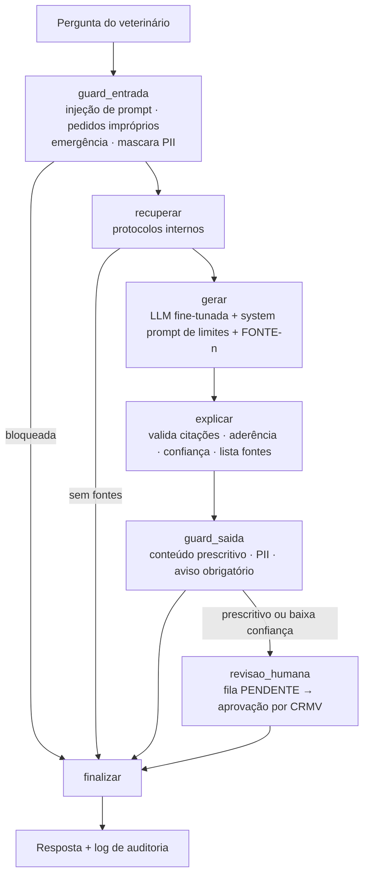

# 🛡️ SmartVET — Segurança e validação do assistente (Fase 3)

Camada que envolve o assistente veterinário (LLM fine-tunada + LangChain/LangGraph) e atende ao requisito **3. Segurança e validação** do Tech Challenge:

| Requisito do desafio | Como foi atendido | Arquivo |
|---|---|---|
| Definir limites de atuação (nunca prescrever sem validação humana) | System prompt com regras explícitas, guardrail de entrada (bloqueio de pedidos impróprios e injeção de prompt), guardrail de saída (detecção de conteúdo prescritivo) e **fila de validação humana** com CRMV | `politicas.py`, `guardrails.py`, `revisao_humana.py` |
| Logging detalhado para rastreamento e auditoria | Log JSONL por evento com `request_id`, dados do tutor mascarados, IDs pseudonimizados e **cadeia de hashes SHA-256** à prova de adulteração; callback LangChain registra prompt, resposta, latência e tokens | `auditoria.py`, `pii.py` |
| Explainability (indicar a fonte da informação) | Contexto numerado `[FONTE-n]`, validação das citações, medida de aderência resposta × fonte, nível de confiança e seção "Fontes consultadas" na resposta | `explicabilidade.py` |

---

## 🔀 Fluxo



Todos os nós gravam eventos no log de auditoria com o mesmo `request_id`.

---

## 🚧 1. Limites de atuação

**System prompt (`SYSTEM_PROMPT_SEGURANCA`)**: o assistente nunca prescreve nem dá diagnóstico definitivo, responde só com base nas fontes, cita `[FONTE-n]`, considera espécie/raça/peso/idade, não revela dados de tutores e ignora instruções que tentem burlar as regras.

Como o prompt sozinho não garante o comportamento, há **guardrails determinísticos** (regex: auditáveis, rápidos e sem custo de outra LLM):

| Camada | Regra | Ação |
|---|---|---|
| Entrada | Injeção de prompt ("ignore as instruções", "mostre o system prompt"…) | `BLOQUEAR` — a LLM nem é chamada |
| Entrada | Falsificação de receita/atestado/carteira de vacinação, dose letal, eutanásia caseira, controlados sem receita, dados de outro tutor, prescrição automática | `BLOQUEAR` |
| Entrada | Sinais de alarme (intoxicação, convulsão, dispneia, torção gástrica, obstrução urinária, atropelamento, hemorragia…) | `PERMITIR` + alerta 🚨 **EMERGÊNCIA** no topo da resposta |
| Recuperação | Nenhum protocolo relevante encontrado | Não chama a LLM; responde que não há respaldo (evita alucinação) |
| Saída | Dose (`mg/kg`, `ml`, `UI`, comprimidos…), posologia (`12/12h`, `VO`, `SC`…) ou verbo prescritivo ("administre", "prescrevo") | `REVISAO_HUMANA` |
| Saída | Fundamentação baixa ou citação de fonte inexistente | `REVISAO_HUMANA` |
| Saída | CPF, telefone, e-mail, CEP ou nome do tutor | Mascarados |
| Saída | Toda resposta | Aviso obrigatório: *"Sugestão de apoio à decisão — não constitui prescrição"* |

**Validação humana (human-in-the-loop)**: respostas retidas ficam `PENDENTE` em `FilaRevisaoHumana` e só viram conduta depois que um médico-veterinário **identificado pelo CRMV** aprova (podendo editar) ou rejeita (com motivo obrigatório). Cada decisão é auditada; uma revisão não pode ser decidida duas vezes.

## 📝 2. Logging e auditoria

Cada evento é uma linha em `logs/auditoria.jsonl`:

```json
{"timestamp": "2026-10-15T23:47:21.939+00:00", "evento": "requisicao_recebida", "nivel": "INFO",
 "request_id": "9f1c…", "versao_modelo": "smartvet-llm-ft-v1",
 "dados": {"pergunta": "Tutora [NOME], CPF [CPF], telefone [TELEFONE]: cão de 10 kg comeu chocolate…",
           "usuario_id": "1b9e0c…", "paciente_id": "a71f2d…", "tutor_id": "c03e99…"},
 "hash_anterior": "5d2a…", "hash": "e81b…"}
```

Eventos registrados: `requisicao_recebida`, `guardrail_entrada`, `retriever_fim`, `fontes_recuperadas`, `llm_inicio` (prompt completo), `llm_fim` (saída, latência, tokens), `explicabilidade`, `guardrail_saida`, `revisao_enfileirada`, `revisao_aprovada`/`revisao_rejeitada`, `alerta_emergencia`, `resposta_entregue`, `tool_*` e erros.

- **Rastreabilidade**: `auditoria.eventos(request_id)` reconstrói toda a jornada de uma pergunta, incluindo qual versão do modelo e quais versões dos protocolos foram usadas.
- **LGPD**: textos passam por mascaramento de PII; IDs de tutor/paciente/veterinário são pseudonimizados com HMAC-SHA256 (configure `AUDIT_SALT` no `.env`). A pergunta já chega mascarada à LLM e ao retriever (minimização de dados).
- **Integridade**: cada linha guarda o hash da anterior. `auditoria.verificar_integridade()` aponta a primeira linha alterada ou removida.

## 🔎 3. Explainability

1. Os documentos recuperados viram fontes numeradas no prompt: `[FONTE-1] Protocolo de Intoxicação por Chocolate — versão 2024-12 — id: PROT-INTOX-003 (protocolo)`.
2. A LLM é obrigada a citar `[FONTE-n]` em cada afirmação.
3. `analisar_resposta` verifica, frase a frase: se há citação, se a fonte citada existe e qual a **aderência** (fração dos termos relevantes da frase presentes na fonte citada).
4. Resultado: nível de confiança `ALTO` / `MEDIO` / `BAIXO`. `BAIXO` envia a resposta para validação humana.
5. A resposta final traz a seção **📚 Fontes consultadas** e o nível de confiança.

Metadados esperados nos documentos do retriever (quem gerar o dataset deve preencher): `id`, `titulo`, `tipo` (protocolo, faq, laudo, receita-modelo…), `versao`.

---

## ▶️ Como usar

```bash
cd src/back-end/fastapi
pip install -r requirements.txt     # LangChain/LangGraph já estão fixados aqui
pip install pytest==8.3.4           # só para rodar os testes

python -m seguranca.demo            # demonstração completa (sem GPU e sem chave de API)
python -m pytest seguranca/tests -q # 35 testes
```

## 🔗 Integração no Smart VET (já aplicada)

O `main.py` instancia `AuditLogger` e `FilaRevisaoHumana` (caminhos em `AUDIT_LOG_PATH` e `REVIEW_QUEUE_PATH`) e registra as rotas `/seguranca/*` com `require_api_key`. Com `API_ENV=Prod`, essas rotas exigem `API_KEY` configurada.

As rotas `/predict/condition` e `/predict/image` passam por `seguranca/predicoes.py`:

| Camada | O que acontece |
|---|---|
| Auditoria | `requisicao_recebida` → `predicao_concluida` → `guardrail_saida` → `resposta_entregue` (ou `predicao_erro`), com o mesmo `request_id`. Imagens são registradas só por tamanho e SHA-256 |
| Guardrail de saída | A interpretação do `LLMInterpreter` é verificada; conteúdo prescritivo vai para a fila de revisão e o `summary` recebe o aviso de retenção |
| PII | Campos de texto da interpretação são mascarados |
| Explicabilidade | `safety.fontes` lista modelo, dataset e a versão (commit no Hugging Face), além do LLM ou das regras que escreveram a interpretação |

A resposta das duas rotas ganhou o campo `safety` (`request_id`, `status`, `motivos`, `alertas`, `revisao_id`, `aviso`, `fontes`). Os campos que já existiam não mudaram.

## 🤝 O que falta: o assistente (responsável: outro desenvolvedor)

A rota `/seguranca/assistente/perguntar` só é criada quando existe o módulo `src/back-end/fastapi/assistente.py`. Nada mais precisa ser alterado: o `main.py` detecta o módulo e monta o grafo seguro (`build_secure_assistant`).

O módulo precisa expor duas funções, que recebem o `Settings` da API (para reaproveitar `LLM_*` se quiser):

```python
# src/back-end/fastapi/assistente.py
def criar_llm(settings):
    """Chat model LangChain: precisa de .invoke(messages) devolvendo um objeto com .content."""
    ...

def criar_retriever(settings):
    """Retriever LangChain: .invoke(pergunta) -> list[Document] com os protocolos clínicos."""
    ...
```

Cada `Document` do retriever deve trazer nos metadados: `id`, `titulo`, `tipo` (protocolo, faq, laudo…) e `versao`. Esses campos aparecem nas citações `[FONTE-n]` e na trilha de auditoria.

As duas funções rodam quando a API sobe; carregar modelos pesados ali atrasa o startup.

Para validar a integração sem a LLM real, use `FakeListChatModel` e `RetrieverPalavrasChave` de `seguranca/demo.py`.

### No grafo do assistente

```python
from seguranca import AuditLogger, FilaRevisaoHumana, construir_grafo_seguro

auditoria = AuditLogger("logs/auditoria.jsonl", versao_modelo="smartvet-llm-ft-v1")
fila = FilaRevisaoHumana("logs/fila_revisao.json", auditoria=auditoria)
grafo = construir_grafo_seguro(llm=modelo_fine_tunado, retriever=vectorstore.as_retriever(),
                               auditoria=auditoria, fila=fila)

resultado = grafo.invoke({
    "pergunta": "Cão com piodermite superficial, qual antibiótico o protocolo indica?",
    "usuario_id": "CRMV-SP-12345", "paciente_id": "PET-4471", "tutor_id": "TUT-3390",
    "contexto_paciente": "Canino, SRD, 12 kg, 5 anos",
})
print(resultado["status"], resultado["resposta"])
```

Se o grupo já tiver um grafo próprio, `criar_nos(...)` devolve os nós como funções para serem adicionados nele.

### Na API FastAPI (`main.py`)

```python
from fastapi import Depends
from security import require_api_key
from seguranca.api import criar_router

app.include_router(criar_router(auditoria, fila, grafo, dependencias=[Depends(require_api_key)]))
```

| Método | Rota | Uso |
|---|---|---|
| POST | `/seguranca/assistente/perguntar` | Pergunta ao assistente com todas as camadas |
| GET | `/seguranca/revisoes/pendentes` | Respostas aguardando validação |
| POST | `/seguranca/revisoes/{id}/aprovar` | Aprova (body: `revisor_crmv`, `comentario`, `resposta_editada`) |
| POST | `/seguranca/revisoes/{id}/rejeitar` | Rejeita (motivo obrigatório) |
| GET | `/seguranca/auditoria/{request_id}` | Trilha completa de uma pergunta |
| GET | `/seguranca/auditoria/integridade` | Verifica a cadeia de hashes do log |

## ⚙️ Configuração

`ConfigSeguranca` permite ajustar: tamanho máximo da pergunta, limiares de aderência (`0,35` médio / `0,60` alto), exigência de revisão para conteúdo prescritivo, bloqueio sem fonte e termos extras de bloqueio.

## ⚠️ Limitações conhecidas

- Os guardrails por regex podem ter falsos positivos/negativos; podem ser complementados por um classificador LLM.
- O mascaramento de nomes depende de receber o nome do tutor (`nomes_sensiveis`); nomes livres exigiriam NER.
- A aderência é lexical: indica se a resposta usa o vocabulário da fonte, não garante correção clínica — por isso a validação humana continua obrigatória para condutas.
- A fila de revisão e o log usam arquivos locais; em produção, usar banco de dados e armazenamento imutável.
